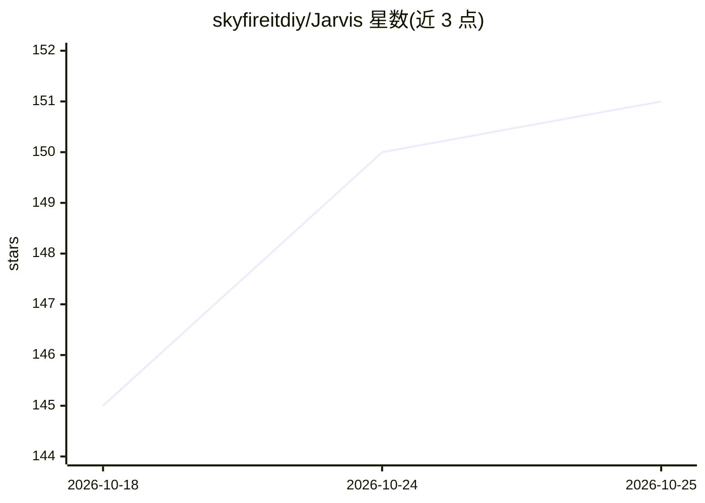

# skyfireitdiy/Jarvis

⭐ 152 · Python · MIT · 推送 2026-10-25 · [GitHub](https://github.com/skyfireitdiy/Jarvis) · 个人维护 · 中文 README

**本地运行的多 Agent 协作式 AI 开发平台，覆盖人×Agent 四种协作模式**

面向开发者的协作式 AI 开发平台，以 CLI、Web 网关与 Python SDK 三种方式提供，覆盖单人单 Agent 到多人多 Agent 四种协作模式。核心机制包括：SQLite 符号数据库做代码理解与影响分析、YAML 声明式多 Agent 编排、JWT 多用户认证与分布式多节点部署、基于 tree-sitter 的八种语言 AST 解析、内核+插件包架构与 MCP 集成。附浏览器扩展（操作真实浏览器）与 Go 编写 的 jarvis-daemon 本地后台服务（文件/进程/GUI 自动化）。安装需 Python 3.12，通过 uv tool 从源码安装，另有一键安装脚本与离线包。

## 筛选速览

| 维度 | 判定 | 备注 |
|---|---|---|
| AI 角色 | `ai-ecosystem` | LLM/agent 周边工具 |
| 许可风险 | `permissive` | MIT |
| 部署形态 | `desktop` | 安装包/桌面程序 |
| 模型依赖 | — | README 未给出锁定关系 |
| 硬件要求 | — | 无带数字的原话,不猜 |
| 安装摩擦 | `low` | 无编译、无系统依赖或容器化 |
| 成熟度 | — | 结构信号不足 |

## 能力要点

- 人×Agent 四象限协作模式（含 JWT 多用户认证与分布式多节点）
- SQLite 符号数据库 + 五类影响分析的结构化代码理解
- YAML 声明式多 Agent 编排，Agent 间群聊/点对点通信
- 浏览器扩展复用真实登录态，jarvis-daemon 提供本机 GUI 自动化

## 适用场景

- 让多个 Agent 组成开发/测试/部署流水线协同写代码并自动验证
- 用符号数据库分析改动影响并评估风险等级
- 团队共享同一 Agent 或搭建跨节点分布式 Agent 网络
- 定时调度 Agent 无人值守执行安全分析、C→Rust 迁移等专项任务

## 场景标签

`多智能体` `Agent 框架` · 领域:Agent 开发

## 证据(README 行号)

> L25: Jarvis 是一个面向开发者的 **协作式 AI 开发平台**。它不只是对话工具，还能真正进入工作流：读代码、改代码、执行工具、管理上下文、复用经验，并在关键节点保持可控。
> L191: |**多 Agent 编排**|YAML 声明式编排一键部署 Agent 网络，Agent 间群聊/点对点通信，多面板同屏操作|

## 星数曲线

2026-10-18 145 → 2026-10-25 151（+6）

---
*卡片 v1 · prompt 1.4 · 生成 2026-10-22 · 置信度 high · 依据 README sha `9e5e5fa06dac` · [字段定义](../../DATASET.md)*
