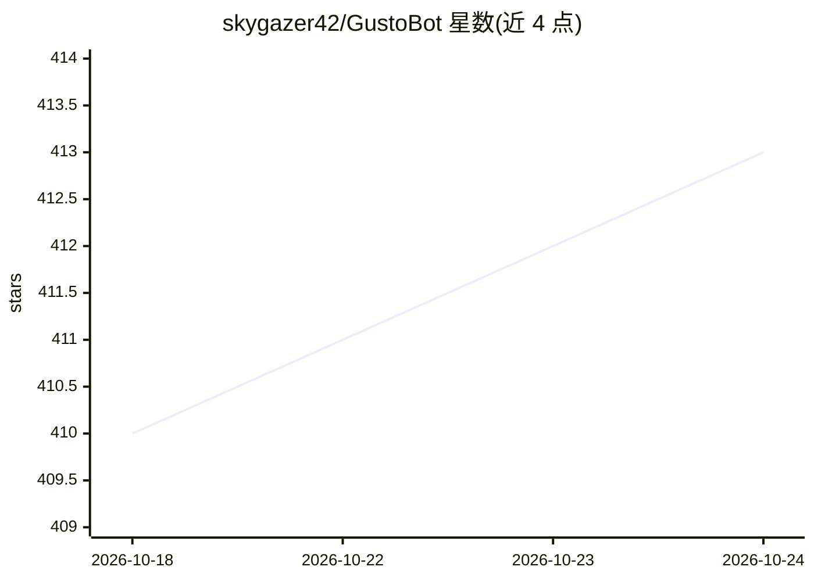

# skygazer42/GustoBot

⭐ 414 · Python · Apache-2.0 · 推送 2026-08-29 · [GitHub](https://github.com/skygazer42/GustoBot) · 组织维护 · 中文 README

**中华菜谱领域的 Multi-Agent 智能客服系统**

以中华菜谱数据为基础的垂直领域智能客服：基于 LangGraph 构建三层 Multi-Agent 架构（主路由层→多工具子图层→原子工具层），融合 Neo4j 图谱推理（Text2Cypher）、MySQL 统计（Text2SQL）、LightRAG/GraphRAG 社区检索、Milvus 与 PostgreSQL pgvector 向量检索，支持图片识别/生成、文件解析等多模态交互，答案带来源标注并有 Guardrails 越界拒绝机制。作者称可作为可迁移的垂直领域智能客服模板，仅需更换知识源与图谱 Schema 即可迁移到其他领域。运行需 Python 3.10、Node.js 16+、Docker，依赖 Neo4j/MySQL/PostgreSQL/Milvus/Redis 等多个存储服务。

## 筛选速览

| 维度 | 判定 | 备注 |
|---|---|---|
| AI 角色 | `ai-native` | 本体是模型或模型工具 |
| 许可风险 | `permissive` | Apache-2.0 |
| 部署形态 | `self-host` | docker 或自建部署 |
| 模型依赖 | — | README 未给出锁定关系 |
| 硬件要求 | — | 无带数字的原话,不猜 |
| 安装摩擦 | `low` | 无编译、无系统依赖或容器化 |
| 成熟度 | — | 结构信号不足 |

## 能力要点

- 三层 Multi-Agent 架构：主路由层 + 多工具子图层 + 原子工具层，LangGraph Subgraph 编排
- 多工具并行查询：Neo4j Cypher、Text2SQL、GraphRAG 社区检索、向量检索可组合调用
- PostgreSQL 优先兜底策略：结构化数据 → 向量检索 → 外部搜索的递进链路
- 多模态交互：菜品图片识别（Vision Model）与生成（CogView-4）、Excel/TXT/Markdown 文件解析

## 适用场景

- 通过自然语言查询菜谱做法、菜系统计与饮食文化典故
- 上传菜品图片识别菜品或按描述生成菜品图片
- 作为模板迁移到其他垂直领域构建专域智能客服

## 场景标签

`多智能体` `知识图谱` `数据分析` `聊天机器人` · 领域:Agent 开发

## 证据(README 行号)

> L7:  智能菜谱客服
> L25: 随着大语言模型（LLM）与知识增强技术的快速发展，将菜谱知识构建为一个**多模态、结构化、可交互的 AI 系统**成为可能。本项目以中华菜谱数据为基础，构建出覆盖菜谱名称、食材、烹饪步骤、营养成分、菜系流派、历史典故等元素的**多

## 星数曲线

2026-10-18 410 → 2026-10-24 413（+3）

---
*卡片 v1 · prompt 1.4 · 生成 2026-10-21 · 置信度 high · 依据 README sha `9a5882d79448` · [字段定义](../../DATASET.md)*
