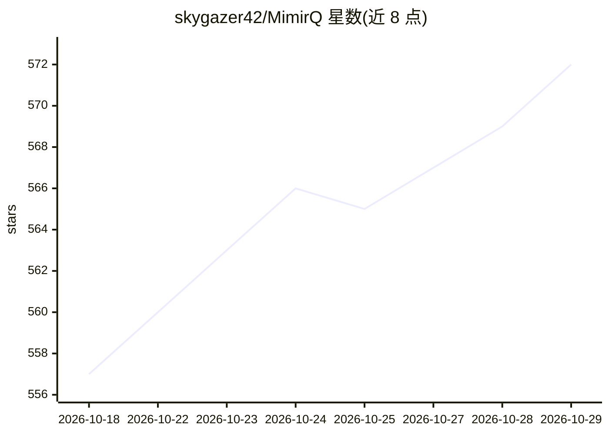

# skygazer42/MimirQ

⭐ 572 · Python · Apache-2.0 · 推送 2026-10-28 · [GitHub](https://github.com/skygazer42/MimirQ) · [官网](https://skygazer42.github.io/MimirQ/handbook/) · 组织维护 · 中文 README

**面向企业的中文优先 RAG 知识库基础设施**

从文档解析到证据引用的企业 RAG 流水线：覆盖 30 种解析后端、86 种切块策略、13 类重排器，支持 Milvus/FAISS/Chroma 向量库与 BM25/SPLADE/ColBERT 混合检索，含数据治理工作台、知识图谱、文档 ACL 与权限、Golden 题集回归评测与质量门禁。可作为 Dify 的外部知识层接入（External Knowledge API 与 Workflow HTTP 节点），起源并已用于市级政务智能问答项目。提供 Docker Compose 一键启动与 Helm/K8s 部署，源码开发需 Python 3.11+ 与 Node.js 20+。

## 筛选速览

| 维度 | 判定 | 备注 |
|---|---|---|
| AI 角色 | `ai-ecosystem` | LLM/agent 周边工具 |
| 许可风险 | `permissive` | Apache-2.0 |
| 部署形态 | `self-host` | docker 或自建部署 |
| 模型依赖 | — | README 未给出锁定关系 |
| 硬件要求 | — | 无带数字的原话,不猜 |
| 安装摩擦 | `low` | 无编译、无系统依赖或容器化 |
| 成熟度 | — | 结构信号不足 |

## 能力要点

- 30 种解析后端、86 种切块策略、13 类重排器，按文档与场景替换
- 切块预览、检索 Trace、逐句引用与证据审计的可视化界面
- Golden 题集回归评测、质量门禁与并发负载门禁
- 原生兼容 Dify External Knowledge API，并提供 Helm/K8s 部署

## 适用场景

- 政务/企业知识库需要按业务替换解析、切块与检索策略并审计引用
- 作为 Dify 应用外挂的可治理 RAG 检索层
- 用固定题集做 RAG 质量回归与发布门禁

## 场景标签

`RAG` `文档解析` `知识图谱` `模型评测` · 领域:评测与运维

## 证据(README 行号)

> L5:  可观察、可替换、可回归的企业 RAG 基础设施 中文优先 · 从文档解析到证据引用，每一步都能检查输入、输出与版本
> L34: > `数据评估` → `场景化解析` → `清洗治理` → `业务切块` → `向量 / 全文索引` → `混合召回` → `重排与引用` → `Golden 回归`
> L183: MimirQ 可作为 Dify 的可治理 RAG 层接入现有应用，不重复实现工作流画布。当前支持两种方式：

## 星数曲线

2026-10-18 557 → 2026-10-29 572（+15）

---
*卡片 v1 · prompt 1.4 · 生成 2026-10-21 · 置信度 high · 依据 README sha `7db3c5cc245c` · [字段定义](../../DATASET.md)*
