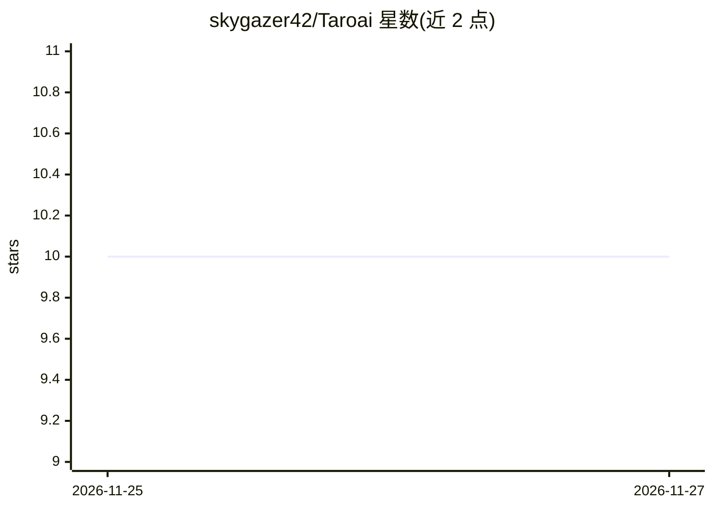

# skygazer42/Taroai

⭐ 10 · Python · 推送 2026-07-27 · [GitHub](https://github.com/skygazer42/Taroai) · 个人维护 · 中文 README

**面向知识工作者和小团队的多租户 Agent 工作空间平台**

以 Agent Loop 为核心的开源企业级 AI Agent 平台，通过一个界面完成对话、联网搜索、文件处理与代码执行，并将流程发布为可复用 Agent。构建侧提供流式对话、模型选择、RAG 与多层记忆；执行侧支持 Skills、MCP 工具调用、沙箱与浏览器隔离运行；治理侧覆盖多租户、RBAC、SSO、审批、评估门禁与计费。基于 Python/FastAPI/PostgreSQL/Redis，通过 Docker Compose 部署，沙箱与浏览器控制器为可选组件，另提供 Helm 与气隙交付入口。

## 筛选速览

| 维度 | 判定 | 备注 |
|---|---|---|
| AI 角色 | `ai-ecosystem` | LLM/agent 周边工具 |
| 许可风险 | `none` | — |
| 部署形态 | `self-host` | docker 或自建部署 |
| 模型依赖 | — | README 未给出锁定关系 |
| 硬件要求 | — | 无带数字的原话,不猜 |
| 安装摩擦 | `low` | 无编译、无系统依赖或容器化 |
| 成熟度 | — | 结构信号不足 |

## 能力要点

- Agent Loop 统一工具调用、沙箱执行与工作流自动化
- 多租户治理：RBAC、SSO、SCIM、审批与评估门禁
- RAG 与多层记忆、MCP 动态工具发现与企业连接器
- Docker Compose/Helm/气隙多种部署入口

## 适用场景

- 小团队用统一界面完成对话、搜索、文件与代码执行
- 把可靠流程发布为可复用的企业 Agent
- 私有化部署并管控多租户的 Agent 使用

## 场景标签

`AI 助手` `RAG` · 领域:对话与助手

## 证据(README 行号)

> L13: Taroai 是面向知识工作者和小团队的云优先、多租户 Agent 工作空间。通过一个界面完成对话、联网搜索、文件处理和代码执行，并将可靠流程发布为可复用 Agent。
> L19: |**Chat 与 Agents** 流式对话、模型选择、Agent 创建与发布|**Skills 与 Tools** 动态工具发现、MCP、企业连接器与审批|**身份与策略** 多租户、RBAC、SSO、SCIM 与 Guard
> L20: |**知识与记忆** 文件摄取、ACL 检索、RAG 与多层记忆|**隔离运行** Sandbox、Browser、Coding Workspace 与 Artifact|**质量与运营** 评估门禁、审计、计费、追踪与定时调度|

## 星数曲线

2026-11-25 10 → 2026-11-27 10（+0）

---
*卡片 v1 · prompt 1.4 · 生成 2026-11-24 · 置信度 mid · 依据 README sha `c28f8065bb40` · [字段定义](../../DATASET.md)*
