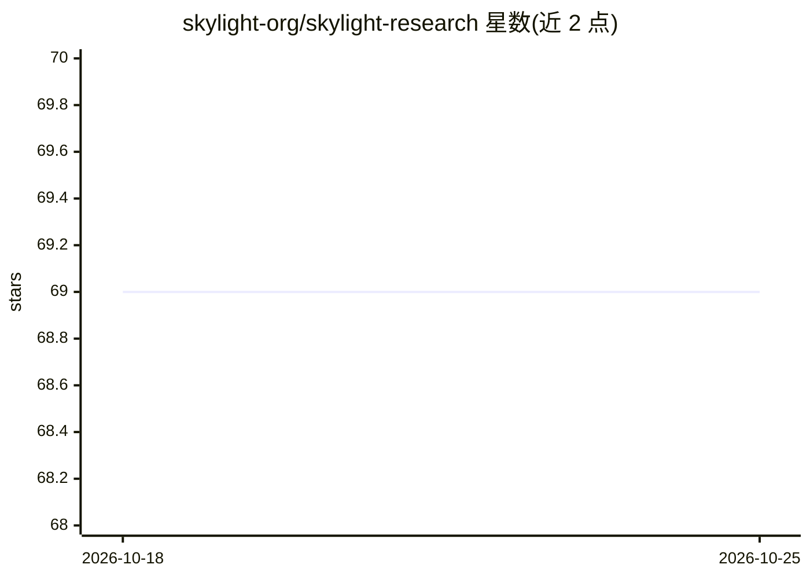

# skylight-org/skylight-research

⭐ 69 · Python · Apache-2.0 · 推送 2026-10-01 · [GitHub](https://github.com/skylight-org/skylight-research) · [官网](https://sky-light.eecs.berkeley.edu) · 组织维护

**研究者的稀疏注意力框架：实现、组合与长文本评测**

面向 Transformer 稀疏注意力研究的框架：以 Mask/Masker 抽象描述与组合注意力模式（HashAttention、vAttention、MagicPig 等机制），提供与 HuggingFace Transformers 集成的 ModelAdapter。内置基于 Ray Tune 的超参搜索与多 GPU 并行优化系统，以及覆盖 LongBench、RULER、InfiniteBench 等 7 个长文本评测数据集的 benchmark 执行器，支持断点续跑与自动评估。通过 git clone 源码安装，用 pytest 运行测试。

## 筛选速览

| 维度 | 判定 | 备注 |
|---|---|---|
| AI 角色 | `ai-ecosystem` | LLM/agent 周边工具 |
| 许可风险 | `permissive` | Apache-2.0 |
| 部署形态 | `None` |  |
| 模型依赖 | — | README 未给出锁定关系 |
| 硬件要求 | — | 无带数字的原话,不猜 |
| 安装摩擦 | `low` | 无编译、无系统依赖或容器化 |
| 成熟度 | — | 结构信号不足 |

## 能力要点

- 可组合的加性 Masker 机制构建稀疏注意力模式
- HuggingFace Transformers 集成适配器（ModelAdapterHF）
- Ray Tune 超参搜索与多 GPU 分布式执行
- 覆盖 LongBench/RULER/InfiniteBench 等 7 个长文本基准的评测系统

## 适用场景

- 实现并组合新的稀疏注意力机制做研究实验
- 在多个长文本基准上评测稀疏注意力配置的精度与性能
- 用 Ray Tune 搜索稀疏配置的最优超参

## 场景标签

`模型评测` · 领域:评测与运维

## 证据(README 行号)

> L3: A comprehensive framework for implementing, experimenting with, and benchmarking sparse attention mechanisms in tran
> L65: The framework includes an optimization system using Ray Tune for hyperparameter search:
> L95: The framework provides a comprehensive benchmarking system that can evaluate sparse attention configurations across

## 星数曲线

2026-10-18 69 → 2026-10-25 69（+0）

---
*卡片 v1 · prompt 1.4 · 生成 2026-10-24 · 置信度 high · 依据 README sha `00b32f41a891` · [字段定义](../../DATASET.md)*
