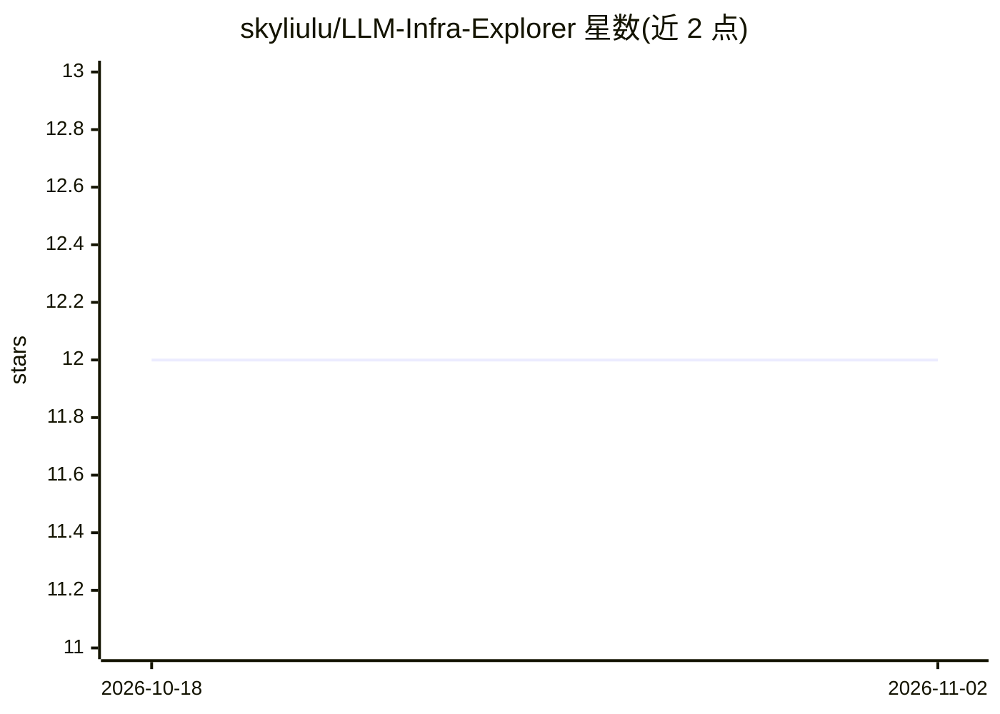

# skyliulu/LLM-Infra-Explorer

⭐ 12 · JavaScript · NOASSERTION · 推送 2026-09-13 · [GitHub](https://github.com/skyliulu/LLM-Infra-Explorer) · [官网](http://skyliulu.github.io/LLM-Infra-Explorer/) · 个人维护 · 中文 README

**LLM 推理系统与底层机制的交互式可视化教学工作台**

基于 React/Vite 的静态 SPA，提供 12 个交互式工作台，覆盖推理流水线、注意力变体（Flash/Sparse/Linear）、量化、KV 缓存分层、并行策略、投机解码、Engram 与 DeepSeek CED 等主题。用户可点击组件检查张量输入输出与来源记录，播放/单步执行有序操作，对比架构与内存开销；支持中英双语、明暗主题与分享链接。资源估算遵循各模块声明的假设与来源，动画节奏为教学演示而非 GPU 基准。

## 筛选速览

| 维度 | 判定 | 备注 |
|---|---|---|
| AI 角色 | `ai-knowledge` | 知识聚合/清单类 |
| 许可风险 | `none` | NOASSERTION |
| 部署形态 | `library` | 以包/库形式分发 |
| 模型依赖 | — | README 未给出锁定关系 |
| 硬件要求 | — | 无带数字的原话,不猜 |
| 安装摩擦 | `medium` | 含编译或系统依赖之一 |
| 成熟度 | — | 结构信号不足 |

## 能力要点

- 12 个工作台覆盖推理、注意力、量化、并行与投机解码等主题
- 点击组件与矩阵记录检查输入、输出与来源
- 有序操作支持播放、暂停与单步执行
- 支持中英双语与分享链接恢复章节与参数

## 适用场景

- 学习 LLM 推理基础设施各子系统的机制与协作方式
- 按推荐路径理解 DeepSeek CED 等架构的设计动因
- 直观对比注意力变体、量化格式与并行策略的资源开销

## 场景标签

`教程课程` · 领域:学习与行业

## 证据(README 行号)

> L7: **Make LLM infrastructure visible.** Trace execution, inspect tensors and memory, and see how the whole system fits 
> L19: |Foundations|**LLM Inference ↗**|Prefill/decode, per-layer KV, Dense/MoE, temperature and sampling.|

## 星数曲线

2026-10-18 12 → 2026-11-02 12（+0）

---
*卡片 v1 · prompt 1.4 · 生成 2026-11-01 · 置信度 high · 依据 README sha `1ae9c89bf032` · [字段定义](../../DATASET.md)*
