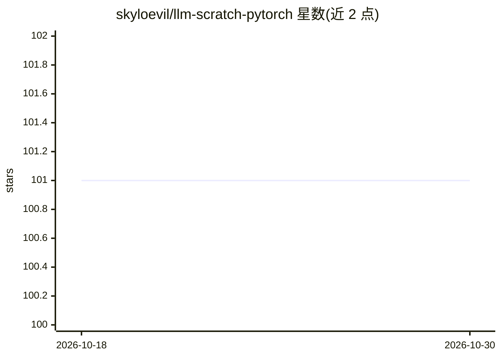

# skyloevil/llm-scratch-pytorch

⭐ 101 · Jupyter Notebook · MIT · 推送 2026-01-27 · [GitHub](https://github.com/skyloevil/llm-scratch-pytorch) · 个人维护 · 中文 README

**PyTorch 从零实现 LLM 的分步学习教程仓库**

面向初学者的 PyTorch 与 LLM 从零实现教程仓库，按进度清单组织三大模块：PyTorch 梯度与计算图基础、GPT-2 从零实现（前 3 节已完成，含混合精度、torch.compile、flash attention 优化至 93ms，DDP 与复现部分未完成）、LLaMA2 与 Flash Attention 从零实现（均未完成）。依赖经 requirements.txt 安装，支持 CUDA 加速（可选），无本地 GPU 时推荐 Runpod 云环境。参考 NanoGPT 等教育实现。

## 筛选速览

| 维度 | 判定 | 备注 |
|---|---|---|
| AI 角色 | `ai-knowledge` | 知识聚合/清单类 |
| 许可风险 | `permissive` | MIT |
| 部署形态 | `library` | 以包/库形式分发 |
| 模型依赖 | — | README 未给出锁定关系 |
| 硬件要求 | — | 无带数字的原话,不猜 |
| 安装摩擦 | `medium` | 含编译或系统依赖之一 |
| 成熟度 | — | 结构信号不足 |

## 能力要点

- GPT-2 从零实现已完成前 3 节（含性能优化至 93ms）
- PyTorch 梯度/计算图/前后向传播基础模块
- LLaMA2 与 Flash Attention（Triton/CUDA）模块已在规划中未实现
- 附 Tokenizer 可视化与 KV Cache 显存计算等推荐工具

## 适用场景

- 系统学习 PyTorch 基础与 LLM 实现原理
- 跟随清单逐步复现 GPT-2 训练与优化流程
- 了解 LLaMA 架构与 Flash Attention 的实现路线

## 场景标签

`教程课程` · 领域:学习与行业

## 证据(README 行号)

> L4: llm-scratch-pytorch - The code is designed to be beginner-friendly, with a focus on understanding the fundamentals o
> L41: ### GPT2 scratch

## 星数曲线

2026-10-18 101 → 2026-10-30 101（+0）

---
*卡片 v1 · prompt 1.4 · 生成 2026-10-23 · 置信度 high · 依据 README sha `0686e1b4b0d0` · [字段定义](../../DATASET.md)*
