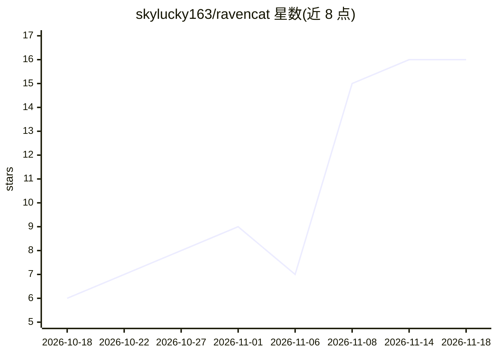

# skylucky163/ravencat

⭐ 16 · TypeScript · MIT · 推送 2026-11-14 · [GitHub](https://github.com/skylucky163/ravencat) · 个人维护 · 中文 README

**面向个人的 Android 多模型 AI 对话客户端**

开源 Android 应用，把可配置的模型服务、单聊与多 AI 群聊整合在一起；每个 AI 可设置名称、人格与模型，聊天记录与设置存储在本地。基于 React Native、Expo、TypeScript 与 SQLite 构建，含语音/视频通话、悬浮窗交互、定时任务、备份恢复与 MCP 外部工具。不内置任何模型服务或 API key，需自行配置。支持 Android 13+，无 iOS 版本；由个人维护，仍在开发中。

## 筛选速览

| 维度 | 判定 | 备注 |
|---|---|---|
| AI 角色 | `ai-native` | 本体是模型或模型工具 |
| 许可风险 | `permissive` | MIT |
| 部署形态 | `desktop` | 安装包/桌面程序 |
| 模型依赖 | — | README 未给出锁定关系 |
| 硬件要求 | — | 无带数字的原话,不猜 |
| 安装摩擦 | `low` | 无编译、无系统依赖或容器化 |
| 成熟度 | — | 结构信号不足 |

## 能力要点

- 单聊与多 AI 群聊，每个 AI 可配置名称、人格与模型
- 可配置语音识别与合成的语音/视频通话，及悬浮窗交互
- 支持 MCP 外部工具、定时任务与主动消息
- 聊天、媒体与设置的本地备份与恢复

## 适用场景

- 在 Android 手机上与多个自配置的 AI 模型分别或同群对话
- 以语音或视频方式与 AI 通话
- 让 AI 执行定时任务并主动发送消息

## 场景标签

`聊天机器人` `语音 Agent` · 领域:对话与助手

## 证据(README 行号)

> L5: **An open-source Android client for multi-model AI conversations.**
> L7: RavenCat brings configurable model services, individual chats, and multi-AI group conversations into one Android app
> L21: - **Individual and group chats**: manage multiple AIs, send text, images, files, and voice messages, and use quoted

## 星数曲线

2026-10-18 6 → 2026-11-18 16（+10）

---
*卡片 v1 · prompt 1.4 · 生成 2026-11-18 · 置信度 high · 依据 README sha `329cb2e41ebc` · [字段定义](../../DATASET.md)*
