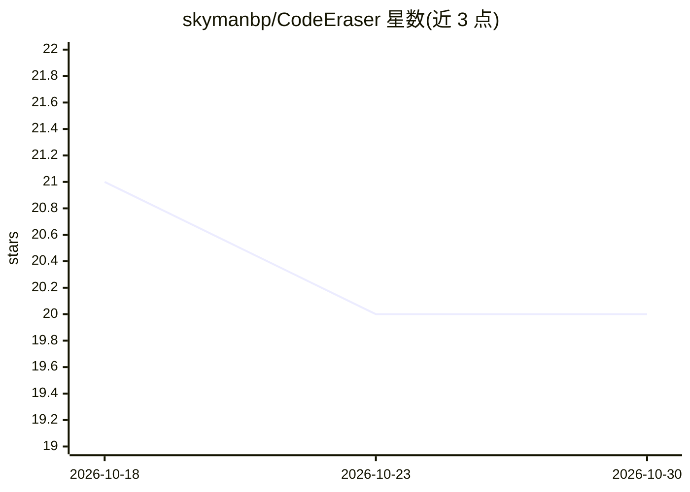

# skymanbp/CodeEraser

⭐ 20 · Haskell · Apache-2.0 · 推送 2026-10-17 · [GitHub](https://github.com/skymanbp/CodeEraser) · [官网](https://codeeraser.dev) · 个人维护 · 中文 README

**拦截 agent 重复/膨胀写入的确定性写时守卫与代码质量工具**

面向 LLM 辅助开发场景的写时守卫：在写入落盘前拒绝复制既有代码或使文件超过行数预算的写入，并以确定性方式判定（README 声明全链路无模型参与）。判定由 Rust 端测量 token 指纹、文档 shingles、引用图等，Haskell 核心裁决结构、克隆与死代码等。支持 13 种语言代码判定，以 CLI、GUI（11 屏）、Claude Code 插件（4 hooks、21 个只读 MCP 工具）、pre-commit 与 CI 形式运行。

## 筛选速览

| 维度 | 判定 | 备注 |
|---|---|---|
| AI 角色 | `ai-ecosystem` | LLM/agent 周边工具 |
| 许可风险 | `permissive` | Apache-2.0 |
| 部署形态 | `library` | 以包/库形式分发 |
| 模型依赖 | — | README 未给出锁定关系 |
| 硬件要求 | — | 无带数字的原话,不猜 |
| 安装摩擦 | `low` | 无编译、无系统依赖或容器化 |
| 成熟度 | — | 结构信号不足 |

## 能力要点

- 写时克隆守卫：50+ 共享 token 的重复写入在落盘前被拒绝并指明重复区域
- 文件行数硬预算与 0-1000 七轴评分、shrink-only 棘轮
- 近失克隆（MinHash/LSH + 树编辑距离）与文档重复检测
- 死代码活性判定、确定性两阶段 erase 与 Datalog 查询

## 适用场景

- 在 agent 编码工作流中拦截复制粘贴式重复与文件膨胀
- CI / precommit 中以统一预算门禁度量代码熵
- 通过 Claude Code hooks 与 MCP 工具在会话内审计 agent 写入

## 场景标签

 · 领域:开发工具/代码质量

## 证据(README 行号)

> L11: LLM-assisted codebases drift the same way: the same function written twice, the same paragraph pasted into three fi
> L19: **Runs as** CLI · GUI ( eleven screens) · Claude Code plugin ( four hooks, one skill, one command, twenty-one read-

## 星数曲线

2026-10-18 21 → 2026-10-30 20（-1）

---
*卡片 v1 · prompt 1.4 · 生成 2026-10-28 · 置信度 high · 依据 README sha `7163bb340510` · [字段定义](../../DATASET.md)*
