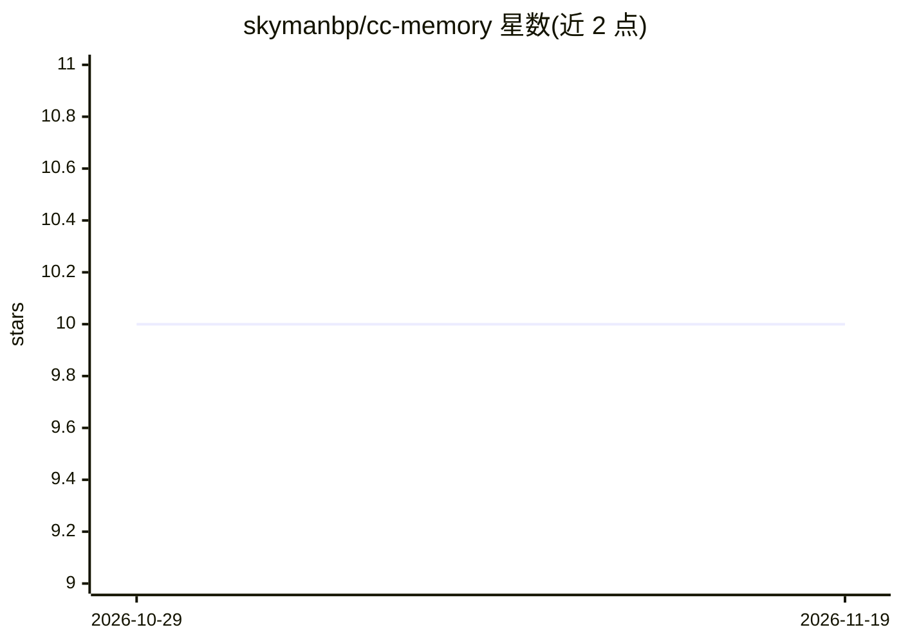

# skymanbp/cc-memory

⭐ 10 · Python · MIT · 推送 2026-11-04 · [GitHub](https://github.com/skymanbp/cc-memory) · [官网](https://github.com/skymanbp/cc-memory#readme) · 个人维护 · 中文 README

**给 Claude Code 提供跨会话持久记忆的插件**

cc-memory 是 Claude Code 插件：六个 hooks、CLI、MCP server、桌面 dashboard 和 web viewer 构建于一个项目级 SQLite 数据库上。在每次对话边界提取结构化记忆，写入时做 reconcile（SKIP/REINFORCE/MERGE/SUPERSEDE/INSERT）而非追加；下次会话强制先读 PROGRESS.md 交接文档，PLAN.md 锚点带受强制执行的用户意图台账，后台按积压合并存储。纯 Python 标准库实现，零运行时依赖；记忆提取需一个凭据，无凭据时仍重写 PROGRESS.md 但不提取记忆。

## 筛选速览

| 维度 | 判定 | 备注 |
|---|---|---|
| AI 角色 | `ai-ecosystem` | LLM/agent 周边工具 |
| 许可风险 | `permissive` | MIT |
| 部署形态 | `desktop` | 安装包/桌面程序 |
| 模型依赖 | — | README 未给出锁定关系 |
| 硬件要求 | — | 无带数字的原话,不猜 |
| 安装摩擦 | `low` | 无编译、无系统依赖或容器化 |
| 成熟度 | — | 结构信号不足 |

## 能力要点

- reconcile-on-write 去重：相似度判定 SKIP/REINFORCE/MERGE/SUPERSEDE/INSERT，CJK 感知相似度
- PROGRESS.md 强制交接：下个会话以 system-reminder 开场必须先读
- Stop hook 拒绝结束回合以强制执行漂移检查与用户意图台账
- FTS5 搜索、MCP 工具、桌面 dashboard 与 web viewer

## 适用场景

- 长项目跨会话保留决策、约束与已修 bug 的记录
- 避免每次会话手动粘贴上下文
- 强制执行用户约束指令不被后续会话违反

## 场景标签

`Agent 记忆` · 领域:Agent 开发

## 证据(README 行号)

> L18: A Claude Code plugin — six hooks , a CLI, an MCP server, a desktop dashboard
> L24: when the write backlog says it is due. Pure Python standard library, zero
> L29: Claude Code **compacts** a conversation when the context window fills.

## 星数曲线

2026-10-29 10 → 2026-11-19 10（+0）

---
*卡片 v1 · prompt 1.4 · 生成 2026-11-19 · 置信度 high · 依据 README sha `58f0975c8098` · [字段定义](../../DATASET.md)*
