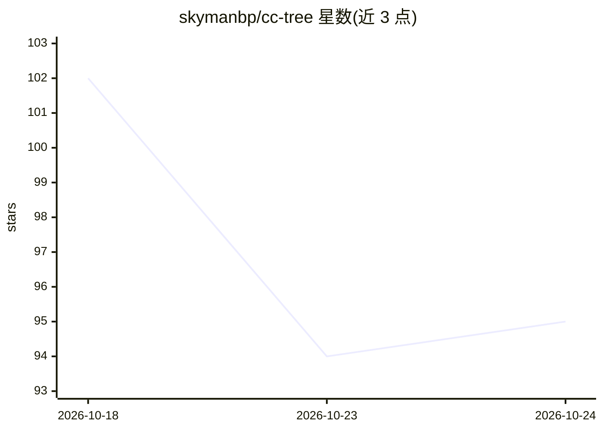

# skymanbp/cc-tree

⭐ 94 · Python · MIT · 推送 2026-10-17 · [GitHub](https://github.com/skymanbp/cc-tree) · [官网](https://github.com/skymanbp/cc-tree#readme) · 个人维护 · 中文 README

**Claude Code 插件：以可审计的径向树结构做发散与对抗式探索**

一个 Claude Code 插件，包含单一探索引擎与可替换预设：brainstorm（发散构思）、attack（对抗式批判）、design（设计空间探索）、code-audit（代码审计）。运行时从根节点向外生长树，每个节点经 12 种框架视角扩展、12 字段推导并附 file:line 或 URL 证据，禁用未完成叶子，仅在六项收敛条件同时满足时停止，也可多阶段链式串联（top-K 管道传递）。产出 tree.md/tree.json 及各预设交付文件。非一次性工具：一次运行可达数分钟到数小时；不内置模型，依赖用户的 Claude Code 模型设置。通过 claude plugin 命令安装，支持自定义预设与断点续跑。

## 筛选速览

| 维度 | 判定 | 备注 |
|---|---|---|
| AI 角色 | `ai-native` | 本体是模型或模型工具 |
| 许可风险 | `permissive` | MIT |
| 部署形态 | `None` |  |
| 模型依赖 | locked-api |  |
| 硬件要求 | — | 无带数字的原话,不猜 |
| 安装摩擦 | `low` | 无编译、无系统依赖或容器化 |
| 成熟度 | — | 结构信号不足 |

## 能力要点

- 单引擎 + 4 个可替换预设，支持自定义 .md 预设
- 每节点 12 种框架视角扩展与 12 字段推导，禁用 defer/future-work 叶子
- 六条件收敛测试，触发上限时报告 WIDTH_CAP/DEPTH_CAP 而非伪装收敛
- tree-chain 多阶段链式运行，top-K 结果在阶段间传递

## 适用场景

- 让 Claude 对文档或论文做逐条可溯源的对抗式批判
- 代码审计时发现威胁模型、契约与跨文件缺陷并附 file:line 证据
- 设计方案比较时穷举选项×权衡×可逆性并输出推荐清单
- 研究方向的发散构思与设计空间探索

## 场景标签

`代码审查` `科研工具` · 领域:编码与开发

## 证据(README 行号)

> L11: **cc-tree makes Claude Code think in a tree you can audit: every node cites evidence, and the run stops when it con
> L44: |**1**|**Divergent exploration** — research directions or solution paths, grown until no new high-value branch appe
> L58:  on your Claude Code model setting; a human decides which leaves to act on.

## 星数曲线

2026-10-18 102 → 2026-10-24 95（-7）

---
*卡片 v1 · prompt 1.4 · 生成 2026-10-24 · 置信度 high · 依据 README sha `27787c98b32f` · [字段定义](../../DATASET.md)*
