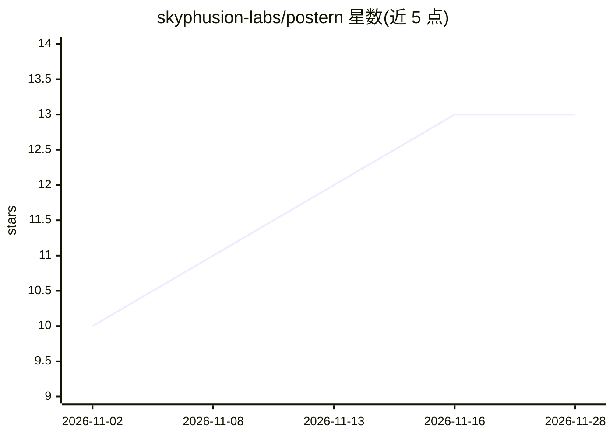

# skyphusion-labs/postern

⭐ 13 · TypeScript · AGPL-3.0 · 推送 2026-11-24 · [GitHub](https://github.com/skyphusion-labs/postern) · [官网](https://demo.posternonline.com) · 组织维护

**自托管邮箱服务：给人类和 agent 各自独立地址与凭证**

运行在 Cloudflare（Workers、D1、R2、Email Routing/Sending）上的自托管邮箱：每个人类和每个 agent 在自有域名下各有一个地址和独立凭证，agent 通过 MCP 服务器（npm 包）读写邮件，人类通过 webmail 和 IMAP 访问同一存储。提供发送、接收、搜索、按身份Scoped token 与审计日志。部署需 Cloudflare 账号与域名；发送邮件需 Workers Paid（5 美元/月）；本地语义搜索依赖 Vectorize 与 Workers AI。

## 筛选速览

| 维度 | 判定 | 备注 |
|---|---|---|
| AI 角色 | `ai-ecosystem` | LLM/agent 周边工具 |
| 许可风险 | `viral` | AGPL-3.0 |
| 部署形态 | `library` | 以包/库形式分发 |
| 模型依赖 | — | README 未给出锁定关系 |
| 硬件要求 | — | 无带数字的原话,不猜 |
| 安装摩擦 | `low` | 无编译、无系统依赖或容器化 |
| 成熟度 | — | 结构信号不足 |

## 能力要点

- 人与 agent 各自地址+独立凭证，agent 经 MCP 服务器访问邮箱
- 六个表面同一存储：Worker 核心、Go SMTP relay、MCP、webmail、IMAP 代理、Python 客户端
- per-identity 凭证运行时可铸造/吊销，带审计日志
- 公开只读 demo 与本地 wrangler dev 路径

## 适用场景

- 给自己的 AI agent 分配独立邮箱地址收发邮件
- 用 Cursor/Claude Code 通过 MCP 搜索和回复邮件
- 用 Thunderbird/mutt 经 IMAP 代理打开同一邮箱
- 在自有域名上托管邮件，不运行传统邮件服务器

## 场景标签

 · 领域:邮件/agent 基础设施

## 证据(README 行号)

> L8: **Agents need their own email.** Postern gives each human and each agent an address on your own
> L74: |**`mcp/`**|MCP server for agents (`@skyphusion/postern-mcp` on npm)|
> L17: `@skyphusion/postern-mcp`.

## 星数曲线

2026-11-02 10 → 2026-11-28 13（+3）

---
*卡片 v1 · prompt 1.4 · 生成 2026-11-18 · 置信度 high · 依据 README sha `881bb87900cc` · [字段定义](../../DATASET.md)*
