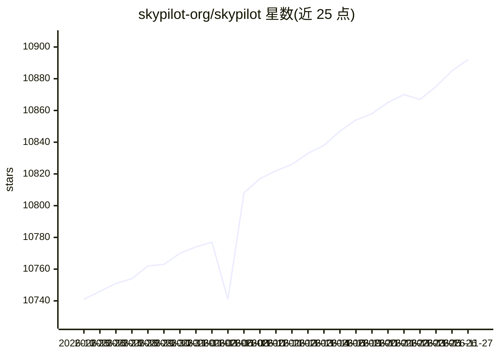

# skypilot-org/skypilot

⭐ 10,892 · Python · Apache-2.0 · 推送 2026-11-26 · [GitHub](https://github.com/skypilot-org/skypilot) · [官网](https://skypilot.ai/) · 组织维护

**统一调度多云与 K8s GPU 算力的 AI 工作负载平台**

SkyPilot 是一个在任意 AI 基础设施（Kubernetes、Slurm、20+ 云）上运行、管理和扩展 AI 工作负载的系统，面向 AI 团队提供简单接口提交任务，向基础设施团队提供统一控制平面。任务以 YAML 或 Python API 声明资源需求、同步数据与命令，平台自动跨集群/云寻找可用且低价的基础设施、供应 GPU/TPU/CPU 并在容量不足时自动故障转移，另提供自动停止闲置资源、工作负载装箱与 gang scheduling 等机制。BYOC 模式：一切在用户自己的云账号与 VPC 内启动。

## 筛选速览

| 维度 | 判定 | 备注 |
|---|---|---|
| AI 角色 | `ai-ecosystem` | LLM/agent 周边工具 |
| 许可风险 | `permissive` | Apache-2.0 |
| 部署形态 | `library` | 以包/库形式分发 |
| 模型依赖 | local-ok | 支持本地模型 |
| 硬件要求 | — | 无带数字的原话,不猜 |
| 安装摩擦 | `low` | 无编译、无系统依赖或容器化 |
| 成熟度 | — | 结构信号不足 |

## 能力要点

- 统一接口调度 Kubernetes、Slurm 与 20+ 云及保留 GPU，支持智能故障转移
- 任务即代码（YAML/Python API），跨基础设施可移植，避免厂商锁定
- 自动停止、装箱与智能调度提升 GPU 资源利用率
- 提供 SkyPilot Skill，可在 Claude Code、Codex 等 agent 中直接调用

## 适用场景

- 在自己的多云与 K8s 集群上排队运行并自动恢复大量训练任务
- 统一管理团队 GPU 资源池并提升利用率
- 在自己拥有的集群上部署生产级推理端点

## 场景标签

`MLOps` `模型训练` `推理引擎` · 领域:训练与推理

## 证据(README 行号)

> L26: SkyPilot is a system to run, manage, and scale AI workloads on any AI infrastructure.
> L118: Once written in this **unified interface** (YAML or Python API), the task can be launched on any available infra (
> L139: SkyPilot then performs the heavy-lifting for you, including:

## 星数曲线

2026-10-25 10,741 → 2026-11-27 10,892（+151）

---
*卡片 v1 · prompt 1.4 · 生成 2026-11-22 · 置信度 high · 依据 README sha `d22c9bb93786` · [字段定义](../../DATASET.md)*
