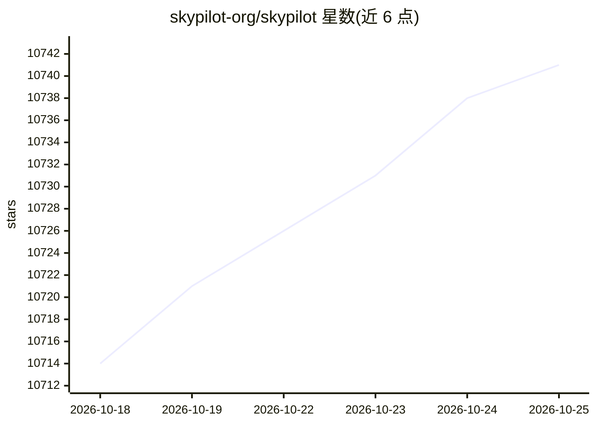

# skypilot-org/skypilot

⭐ 10,741 · Python · Apache-2.0 · 推送 2026-10-24 · [GitHub](https://github.com/skypilot-org/skypilot) · [官网](https://skypilot.ai/) · 组织维护

**跨云/集群运行管理 AI 与 GPU 工作负载的统一平台**

SkyPilot 是一个在任何 AI 基础设施（Kubernetes、Slurm、20+ 云）上运行、管理和扩展 AI 工作负载的系统：用 YAML 或 Python API 声明任务，由其寻找最便宜可用的基础设施、供应 GPU/TPU/CPU 并支持故障切换、同步代码、自动装依赖、运行任务与流式日志。面向 AI 团队（快速起算力）与基础设施团队（统一控制平面：gang 调度、装箱、自动停机、多集群管理）。BYOC 模式，所有资源运行在用户自有云账户与集群内。pip 安装。

## 筛选速览

| 维度 | 判定 | 备注 |
|---|---|---|
| AI 角色 | `ai-ecosystem` | LLM/agent 周边工具 |
| 许可风险 | `permissive` | Apache-2.0 |
| 部署形态 | `library` | 以包/库形式分发 |
| 模型依赖 | local-ok | 支持本地模型 |
| 硬件要求 | — | 无带数字的原话,不猜 |
| 安装摩擦 | `low` | 无编译、无系统依赖或容器化 |
| 成熟度 | — | 结构信号不足 |

## 能力要点

- YAML/Python 统一接口描述任务，可在 Kubernetes/Slurm/20+ 云间移植
- 自动寻找最便宜可用资源、供应 GPU/TPU/CPU 并带故障切换
- gang 调度、装箱、空闲资源自动清理、多集群统一控制平面
- 内置训练/服务（vLLM、SGLang、Ollama）/模型（DeepSeek、Llama、Qwen 等）示例

## 适用场景

- 在多云与自有集群间统一调度 GPU 训练/推理任务
- 提高自有 Kubernetes/Slurm 集群的 GPU 利用率
- 以代码方式定义任务，避免云厂商锁定
- 在自有基础设施上部署 LLM 服务

## 场景标签

`MLOps` · 领域:训练与推理

## 证据(README 行号)

> L25: SkyPilot is a system to run, manage, and scale AI workloads on any AI infrastructure.
> L60: - One interface to use reserved GPUs, Kubernetes clusters, Slurm clusters, or 20+ clouds
> L116: Once written in this **unified interface** (YAML or Python API), the task can be launched on any available infra (

## 星数曲线

2026-10-18 10,714 → 2026-10-25 10,741（+27）

---
*卡片 v1 · prompt 1.4 · 生成 2026-10-20 · 置信度 high · 依据 README sha `7bf0844e3e78` · [字段定义](../../DATASET.md)*
