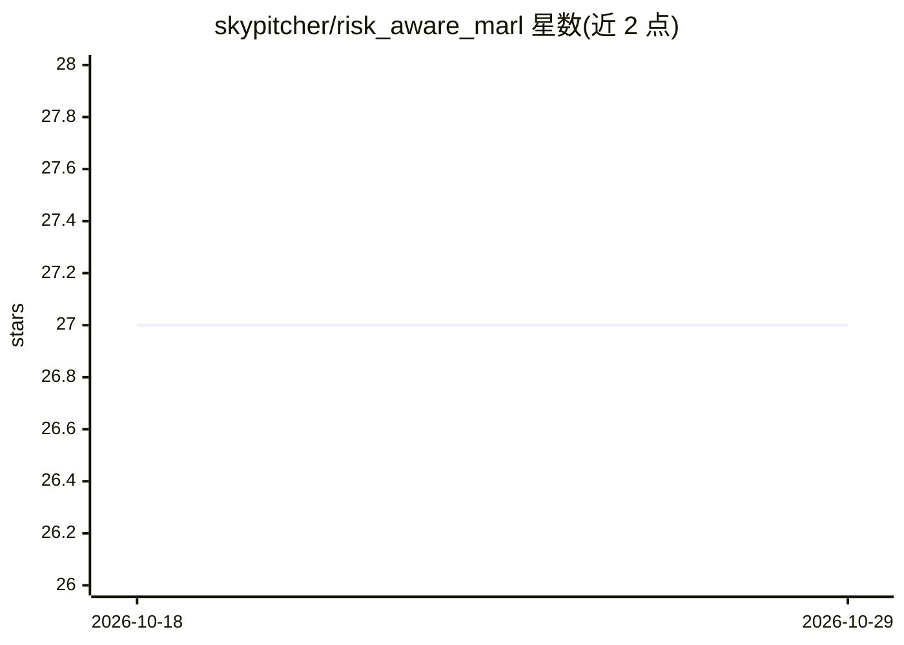

# skypitcher/risk_aware_marl

⭐ 27 · Python · MIT · 推送 2026-07-20 · [GitHub](https://github.com/skypitcher/risk_aware_marl) · 个人维护

**超密集 LEO 卫星网络的风险感知多智能体强化学习路由框架**

论文 "Asynchronous Risk-Aware Multi-Agent Packet Routing for Ultra-Dense LEO Satellite Networks" 的官方实现：提出 PRIMAL 框架（PRIMAL-CVaR/PRIMAL-Avg），以 Implicit Quantile Networks 学习路由开销分布并通过 CVaR 约束控制尾部风险，采用原对偶优化避免人工奖励设计；内置轻量事件驱动的卫星网络仿真器作为离线训练环境，面向 1584 颗 Starlink 一期卫星规模。同时提供 SPF/MADQN/MaIQN/MaSAC 基线实现，支持单机训练与 SLURM 分布式训练，供卫星网络与强化学习方向的研究者复现实验。

## 筛选速览

| 维度 | 判定 | 备注 |
|---|---|---|
| AI 角色 | `ai-native` | 本体是模型或模型工具 |
| 许可风险 | `permissive` | MIT |
| 部署形态 | `library` | 以包/库形式分发 |
| 模型依赖 | — | README 未给出锁定关系 |
| 硬件要求 | — | 无带数字的原话,不猜 |
| 安装摩擦 | `medium` | 含编译或系统依赖之一 |
| 成熟度 | — | 结构信号不足 |

## 能力要点

- 事件驱动仿真器原生集成多智能体 RL 训练，无需人工回合边界
- PRIMAL-CVaR：Implicit Quantile Networks + CVaR 约束控制尾部风险
- 包含 SPF/MADQN/MaIQN/MaSAC 四种基线算法实现
- 支持单机训练与 SLURM 集群分布式训练

## 适用场景

- 复现论文中超密集 LEO 星座的路由实验结果
- 在该仿真器上训练或对比自己的路由算法
- 研究风险约束强化学习在网络路由中的应用

## 场景标签

`多智能体` `强化学习` · 领域:Agent 开发

## 证据(README 行号)

> L18: This repository presents **PRIMAL** (Principled Risk-aware Independent Multi-Agent Learning), a novel multi-agent d
> L20: This codebase contains a light-weight even-driven simulator for LEO satellite communications used as the environmen

## 星数曲线

2026-10-18 27 → 2026-10-29 27（+0）

---
*卡片 v1 · prompt 1.4 · 生成 2026-10-26 · 置信度 mid · 依据 README sha `efd3cabbf263` · [字段定义](../../DATASET.md)*
