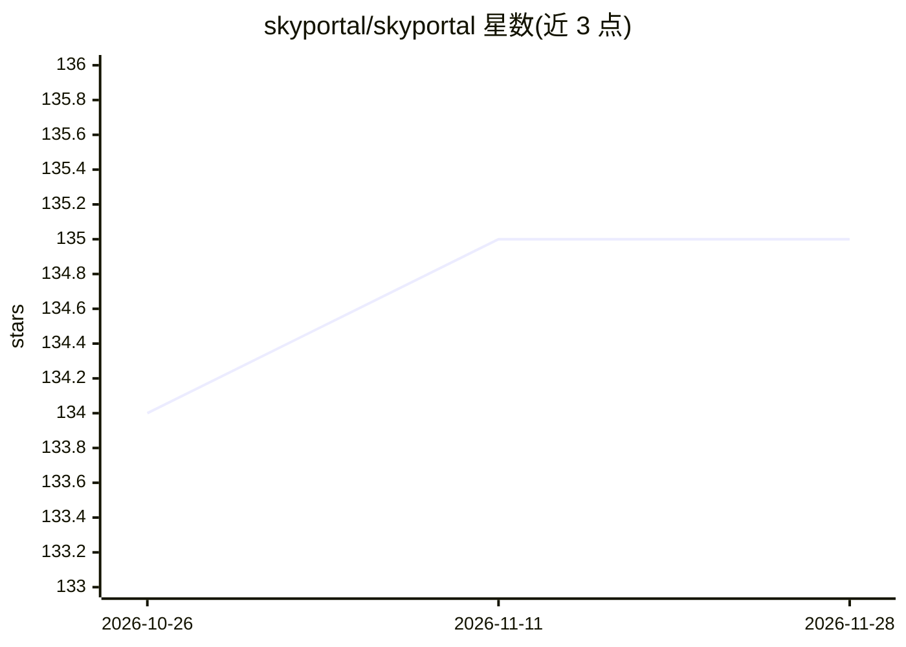

# skyportal/skyportal

⭐ 135 · Python · NOASSERTION · 推送 2026-11-27 · [GitHub](https://github.com/skyportal/skyportal) · [官网](https://skyportal.io) · 组织维护

**面向天文研究团队的时域天文数据协作平台**

SkyPortal 是一个天文数据平台，为时域天文学研究提供协作功能，支持团队围绕暂现源与变星等天文事件开展数据查看与管理。README 本身内容简短，安装与使用方式均指向外部项目文档，未在页面内给出具体命令；项目附有 JOSS 论文与配套论文供引用，经费来源包括 Moore 基金会与 NSF 的 A3D3 研究所。主题标签包含 machine-learning，但 README 未说明 ML 功能细节。

## 筛选速览

| 维度 | 判定 | 备注 |
|---|---|---|
| AI 角色 | `ai-enhanced` | 去掉 AI 部分产品仍成立 |
| 许可风险 | `none` | NOASSERTION |
| 部署形态 | `None` |  |
| 模型依赖 | — | README 未给出锁定关系 |
| 硬件要求 | — | 无带数字的原话,不猜 |
| 安装摩擦 | `low` | 无编译、无系统依赖或容器化 |
| 成熟度 | — | 结构信号不足 |

## 能力要点

- 面向时域天文学的协作式数据平台
- 提供 JOSS 论文与配套论文的引用信息（含 BibTeX）
- 由 Moore 基金会与 NSF A3D3 资助

## 适用场景

- 天文团队协作浏览和管理暂现源观测数据
- 为 LSST 等巡天项目的天象事件跟进提供平台
- 学术发表时按官方 BibTeX 引用该平台

## 场景标签

`科研工具` · 领域:学习与行业

## 证据(README 行号)

> L9: An Astronomical Data Platform
> L23: When utilizing this code for a publication, kindly make a reference to the package by its name, SkyPortal, and cita
> L37: We gratefully acknowledge previous and current support from the Gordon and Betty Moore Foundation, through both the

## 星数曲线

2026-10-26 134 → 2026-11-28 135（+1）

---
*卡片 v1 · prompt 1.4 · 生成 2026-11-28 · 置信度 low · 依据 README sha `b653a5fa580d` · [字段定义](../../DATASET.md)*
