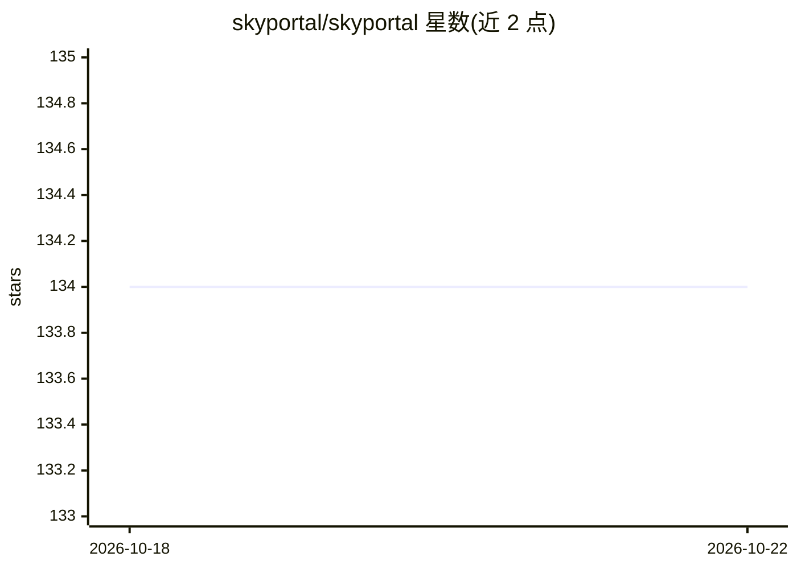

# skyportal/skyportal

⭐ 134 · Python · NOASSERTION · 推送 2026-10-22 · [GitHub](https://github.com/skyportal/skyportal) · [官网](https://skyportal.io) · 组织维护

**时域天文协作数据平台，供天文学家共享分析瞬变源数据**

面向时域天文学研究的天文数据平台，支持瞬变源、变星等时域天文数据的协作管理与数据科学分析；README 指向项目主页与文档获取安装使用说明。项目由 Moore 基金会与 NSF（A3D3）资助开发，配套发表论文（JOSS 与 ApJS），主题标签含 machine-learning 与 LSST。README 本身不含具体功能与安装命令细节，主要信息需从文档获取。

## 筛选速览

| 维度 | 判定 | 备注 |
|---|---|---|
| AI 角色 | `ai-ecosystem` | LLM/agent 周边工具 |
| 许可风险 | `none` | NOASSERTION |
| 部署形态 | `None` |  |
| 模型依赖 | — | README 未给出锁定关系 |
| 硬件要求 | — | 无带数字的原话,不猜 |
| 安装摩擦 | `low` | 无编译、无系统依赖或容器化 |
| 成熟度 | — | 结构信号不足 |

## 能力要点

- 时域天文（瞬变源/变星）数据平台
- 面向天文学者的协作研究平台
- 配套 JOSS/ApJS 发表论文
- 由 Moore 基金会与 NSF A3D3 资助

## 适用场景

- 天文学团队协作管理时域巡天数据
- 瞬变源与变星的观测数据分析
- 作为天文数据科学研究的平台基础设施

## 场景标签

 · 领域:天文学/科研数据平台

## 证据(README 行号)

> L9: An Astronomical Data Platform
> L37: We gratefully acknowledge previous and current support from the Gordon and Betty Moore Foundation, through both the

## 星数曲线

2026-10-18 134 → 2026-10-22 134（+0）

---
*卡片 v1 · prompt 1.4 · 生成 2026-10-22 · 置信度 low · 依据 README sha `df50d0b9f2d3` · [字段定义](../../DATASET.md)*
