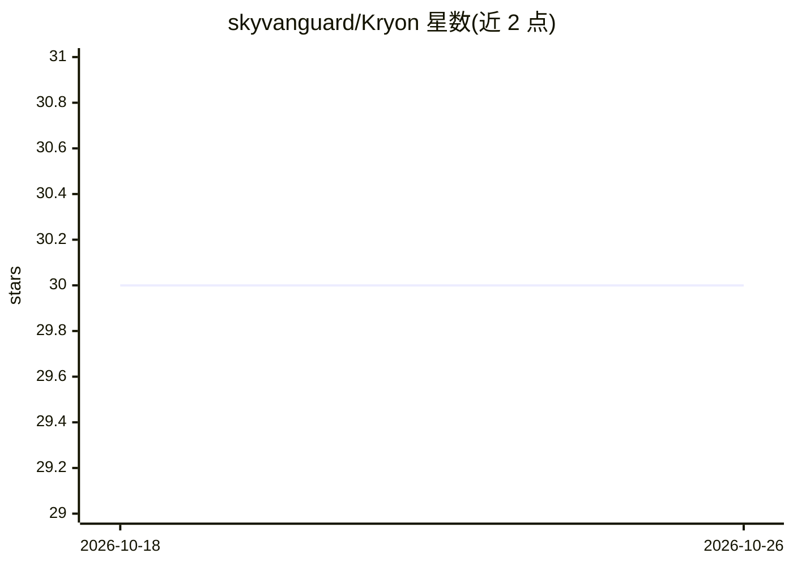

# skyvanguard/Kryon

⭐ 30 · Python · AGPL-3.0 · 推送 2026-08-12 · [GitHub](https://github.com/skyvanguard/Kryon) · [官网](https://www.skyvanguard.com.py) · 个人维护

**本地优先的自主攻防安全 agent：一条提示词完成侦察与合规审计**

面向授权渗透测试与合规审计场景的自主安全 agent。以单条提示词驱动侦察、漏洞挖掘、DFIR 与合规审计（PCI-DSS、HIPAA、GDPR 等 12 个框架模块），输出 PDF 报告与 JSON 发现。关键机制是确定性优先：nuclei/nikto/sqlmap 等检测器作为 pre-hooks 在 LLM 介入前运行，模型仅陈述证据；110 个 markdown 技能手册按目标自动匹配。运行于本地 llama.cpp 提供的 OpenAI 兼容模型，可换云端端点。侵入式工具由 KRYON_RED_TEAM 门控，默认被动模式。

## 筛选速览

| 维度 | 判定 | 备注 |
|---|---|---|
| AI 角色 | `ai-native` | 本体是模型或模型工具 |
| 许可风险 | `viral` | AGPL-3.0 |
| 部署形态 | `self-host` | docker 或自建部署 |
| 模型依赖 | — | README 未给出锁定关系 |
| 硬件要求 | — | 无带数字的原话,不猜 |
| 安装摩擦 | `low` | 无编译、无系统依赖或容器化 |
| 成熟度 | — | 结构信号不足 |

## 能力要点

- 确定性 pre-hooks 在 LLM 之前运行检测器，模型不可跳过扫描
- 110 个 markdown 技能手册 + 362 个函数工具 + 12 个合规模块
- 四 种执行模式：engage/investigate/queue/schedule（持续监控并 diff 到 SIEM）
- 本地 llama.cpp 运行 OpenAI 兼容模型，零 API 成本

## 适用场景

- 对授权目标做自动化侦察、渗透测试与漏洞挖掘
- 按 PCI-DSS/HIPAA/GDPR 等框架执行合规审计并出报告
- 对网络段做多目标 POC 扫描与持续监控告警

## 场景标签

`网络安全` · 领域:学习与行业

## 证据(README 行号)

> L25: **Kryon is a local-first, autonomous offensive-security agent.** Point it at a target and — from a single prompt — 
> L27: It runs **fully on your own hardware** — a local, OpenAI-compatible LLM served via llama.cpp — so there's **zero AP
> L33: Architecture is **skill-based**: one unified "Kryon" agent dynamically loads **~110 markdown playbooks** based on t

## 星数曲线

2026-10-18 30 → 2026-10-26 30（+0）

---
*卡片 v1 · prompt 1.4 · 生成 2026-10-26 · 置信度 high · 依据 README sha `3e6275ac1f69` · [字段定义](../../DATASET.md)*
