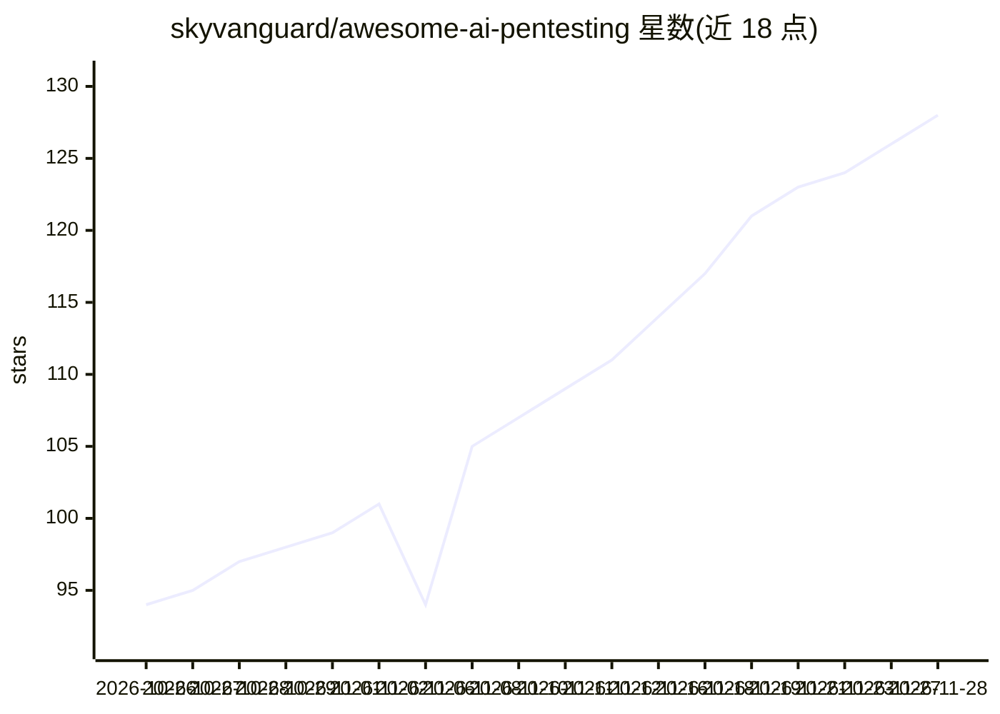

# skyvanguard/awesome-ai-pentesting

⭐ 128 · Python · MIT · 推送 2026-11-25 · [GitHub](https://github.com/skyvanguard/awesome-ai-pentesting) · [官网](https://www.skyvanguard.com.py) · 个人维护

**面向安全测试人员的 AI 渗透测试工具清单**

一份按类别组织的精选清单，收录将 LLM、机器学习与自主 agent 用于渗透测试、漏洞赏金、红队与网络安全运营的开源项目。条目分为自主渗透测试 agent、安全 MCP 服务器、漏洞赏金与侦察 AI 等板块，每个条目附描述与所支持的模型后端说明。内容由个人维护者策展，另提供免费课程链接。

## 筛选速览

| 维度 | 判定 | 备注 |
|---|---|---|
| AI 角色 | `ai-knowledge` | 知识聚合/清单类 |
| 许可风险 | `permissive` | MIT |
| 部署形态 | `None` |  |
| 模型依赖 | — | README 未给出锁定关系 |
| 硬件要求 | — | 无带数字的原话,不猜 |
| 安装摩擦 | `low` | 无编译、无系统依赖或容器化 |
| 成熟度 | — | 结构信号不足 |

## 能力要点

- 收录数十个自主 AI 渗透测试 agent 并标注其支持的模型后端
- 汇总面向安全工具的 MCP 服务器（逆向、扫描、APK 分析等）
- 覆盖渗透测试、漏洞赏金、红队、OSINT 等安全场景

## 适用场景

- 查找可用于授权渗透测试的 AI agent 工具
- 为安全工作流挑选合适的 MCP 服务器
- 了解 AI 与攻防安全结合的开源项目生态

## 场景标签

`精选清单` `网络安全` · 领域:学习与行业

## 证据(README 行号)

> L1: # Awesome AI Pentesting Awesome
> L3: > A curated list of AI-powered tools, frameworks, and resources for penetration testing, bug bounty hunting, red tea
> L15: ## Autonomous AI Pentesting Agents

## 星数曲线

2026-10-26 94 → 2026-11-28 128（+34）

---
*卡片 v1 · prompt 1.4 · 生成 2026-11-28 · 置信度 high · 依据 README sha `842de3b9279f` · [字段定义](../../DATASET.md)*
