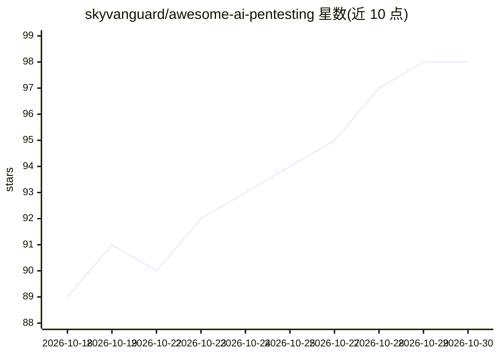

# skyvanguard/awesome-ai-pentesting

⭐ 98 · Python · MIT · 推送 2026-10-25 · [GitHub](https://github.com/skyvanguard/awesome-ai-pentesting) · [官网](https://www.skyvanguard.com.py) · 个人维护

**AI 渗透测试工具与 MCP 安全资源策展清单**

由 SkyVanguard 个人维护的 awesome 类策展清单，收录利用 LLM、机器学习与自主 agent 的网络安全开源项目，覆盖自主渗透测试 agent、安全类 MCP 服务器、漏洞赏金与侦察工具、CTF 解题工具、漏洞分析与扫描五大类，每条目给出描述与所支持的 AI 模型后端（如 OpenAI、Claude、Ollama）。条目为表格组织，标注星标更新时间。清单同时链接维护者的免费 AI 渗透测试课程站点。

## 筛选速览

| 维度 | 判定 | 备注 |
|---|---|---|
| AI 角色 | `ai-knowledge` | 知识聚合/清单类 |
| 许可风险 | `permissive` | MIT |
| 部署形态 | `None` |  |
| 模型依赖 | — | README 未给出锁定关系 |
| 硬件要求 | — | 无带数字的原话,不猜 |
| 安装摩擦 | `low` | 无编译、无系统依赖或容器化 |
| 成熟度 | — | 结构信号不足 |

## 能力要点

- 收录自主 AI 渗透测试 agent、安全 MCP 服务器、CTF 工具等五大类条目
- 每条目标注所支持的 LLM 后端（OpenAI/Anthropic/Ollama 等）
- 覆盖漏洞赏金、红队、OSINT 与逆向工程场景

## 适用场景

- 寻找可用于渗透测试或红队作业的 AI 工具
- 查找安全领域的 MCP 服务器实现
- 比较各 AI 安全工具支持的模型后端

## 场景标签

`精选清单` `网络安全` · 领域:学习与行业

## 证据(README 行号)

> L1: # Awesome AI Pentesting Awesome
> L3: > A curated list of AI-powered tools, frameworks, and resources for penetration testing, bug bounty hunting, red tea
> L5: The intersection of Artificial Intelligence and offensive/defensive security is evolving rapidly. This list tracks t

## 星数曲线

2026-10-18 89 → 2026-10-30 98（+9）

---
*卡片 v1 · prompt 1.4 · 生成 2026-10-23 · 置信度 high · 依据 README sha `91b635018dfa` · [字段定义](../../DATASET.md)*
