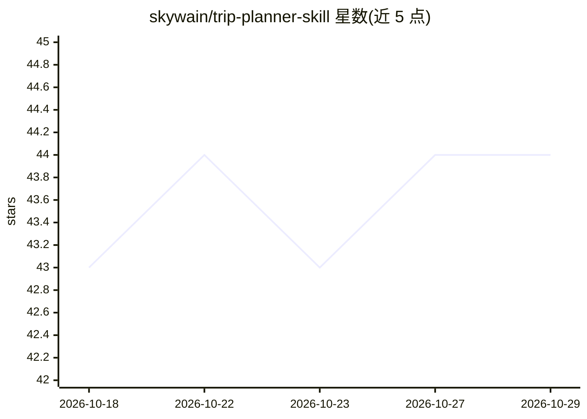

# skywain/trip-planner-skill

⭐ 44 · Python · MIT · 推送 2026-10-10 · [GitHub](https://github.com/skywain/trip-planner-skill) · 个人维护 · 中文 README

**旅行规划 Agent 技能：一句话生成逐小时可预订行程页**

开放格式 Agent Skill（SKILL.md），运行于 Claude Code、Codex、Gemini CLI、Cursor、GitHub Copilot 等加载 Agent Skills 的编码代理中。输入一句话需求，产出城市路线骨架、真实机票价格网格、逐小时日程（用工具核验开放时间/价格/节假日而非猜测）、按街区筛选的酒店候选、按截止日期排序的预订清单与 .ics 日历，最终经八种主题渲染器之一渲染为单文件 HTML 页面，并以 plan.geo.json 为单一数据源生成离线 KML 地图。不代用户预订或支付。图片生成走三级降级：代理原生生成 → 用户 OpenRouter key → 内置素材库。需 Python 3.9+，fast-flights 与 Pillow 为可选依赖。仅在 Claude Code 中验证过，其他代理未测试。

## 筛选速览

| 维度 | 判定 | 备注 |
|---|---|---|
| AI 角色 | `ai-native` | 本体是模型或模型工具 |
| 许可风险 | `permissive` | MIT |
| 部署形态 | `library` | 以包/库形式分发 |
| 模型依赖 | — | README 未给出锁定关系 |
| 硬件要求 | — | 无带数字的原话,不猜 |
| 安装摩擦 | `low` | 无编译、无系统依赖或容器化 |
| 成熟度 | `idea` | |

## 能力要点

- 逐小时日程，开放时间/闭馆日/节假日用工具核验
- plan.geo.json 单一数据源派生主题 HTML 页、地图链接与离线 KML
- 八种主题渲染器（illustrated/clay/noir/glass/journal/zine/splash/portal）
- 图片三级降级：原生生成 → OpenRouter key → 内置素材库

## 适用场景

- 让我的编码代理用一句话规划多日跨国行程并生成设计页
- 比价真实机票并得到按截止日期排序的预订清单与日历
- 离线场景用 Organic Maps / Google My Maps 打开行程 KML

## 场景标签

 · 领域:旅行规划/Agent 技能

## 证据(README 行号)

> L6: designed page in one of eight visual themes.** An open-format Agent Skill (`SKILL.md`)
> L17: Verified in: Claude Code (others untested)
> L163:  OpenRouter **key** → the built-in **stock kit**. The last rung still ships a themed

## 星数曲线

2026-10-18 43 → 2026-10-29 44（+1）

---
*卡片 v1 · prompt 1.4 · 生成 2026-10-25 · 置信度 mid · 依据 README sha `6640901a87f8` · [字段定义](../../DATASET.md)*
