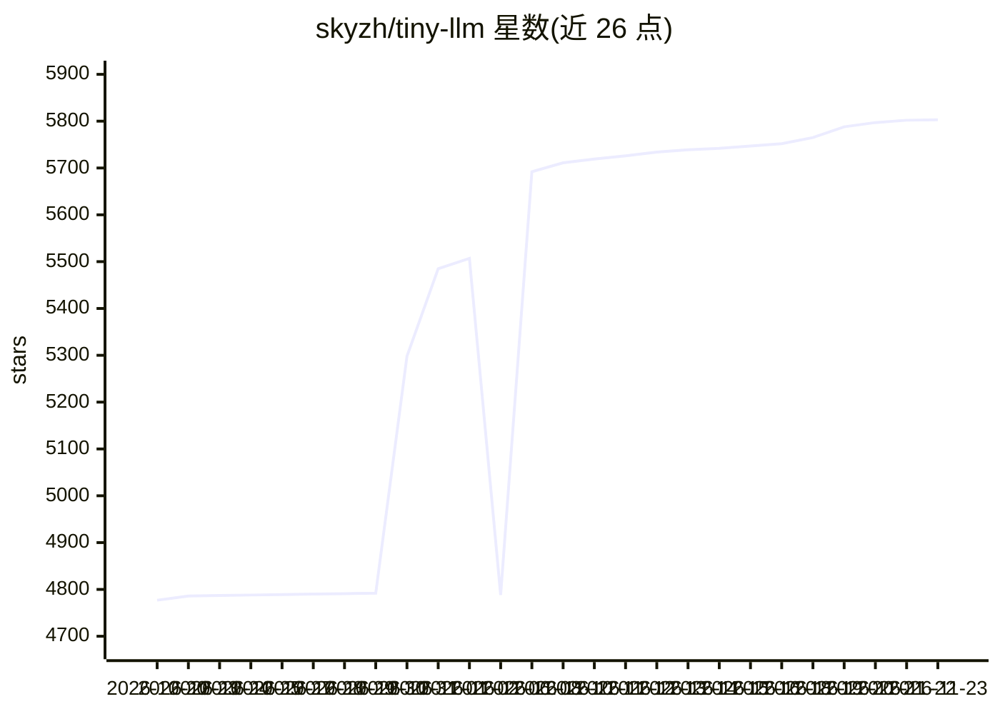

# skyzh/tiny-llm

⭐ 5,803 · Python · Apache-2.0 · 推送 2026-11-22 · [GitHub](https://github.com/skyzh/tiny-llm) · [官网](https://tiny-llm.dev) · 个人维护

**面向系统工程师的 LLM 推理系统实践课程（Apple Silicon）**

tiny-llm 是一门面向系统工程师的实践课程，目标是端到端理解 LLM 推理。课程基于 MLX 数组与 MLX 扩展运行时，不使用高层神经网络层：学员在 Python、C++ 或 Metal 中实现算子，MLX 作为正确性参照与性能基线。路径为四周：从矩阵运算搭建 Qwen3 模型、KV-cache 与量化/SIMD 优化、实现 continuous batching 与 paged KV 的 mini vLLM，到构建带校验边界的 coding agent。课程环境需 Apple Silicon（共享内存与 Metal 内核）。

## 筛选速览

| 维度 | 判定 | 备注 |
|---|---|---|
| AI 角色 | `ai-knowledge` | 知识聚合/清单类 |
| 许可风险 | `permissive` | Apache-2.0 |
| 部署形态 | `None` |  |
| 模型依赖 | — | README 未给出锁定关系 |
| 硬件要求 | — | 无带数字的原话,不猜 |
| 安装摩擦 | `medium` | 含编译或系统依赖之一 |
| 成熟度 | — | 结构信号不足 |

## 能力要点

- 四部分路径：Qwen3 模型搭建 → 单请求优化 → mini vLLM → coding agent
- 在 Python/C++/Metal 中手动实现算子，MLX 作正确性参照与性能基线
- 将公式与内存流量、kernel 占用、KV-cache、批处理、调度关联
- 配套参考实现 tiny_llm_ref 与测试/基准附录

## 适用场景

- 系统工程师想端到端理解 LLM 推理链路
- 在本地 Apple Silicon 上学习 kernel 与服务机制
- 动手实现 continuous batching 与 paged KV-cache

## 场景标签

`教程课程` · 领域:学习与行业

## 证据(README 行号)

> L5: tiny-llm is a hands-on course for systems engineers who want to understand LLM
> L17: The course is built on MLX arrays and the MLX extension runtime, without using
> L25: The course follows a four-week learning path:

## 星数曲线

2026-10-20 4,777 → 2026-11-23 5,803（+1,026）

---
*卡片 v1 · prompt 1.4 · 生成 2026-11-22 · 置信度 high · 依据 README sha `bc19b8c1c025` · [字段定义](../../DATASET.md)*
