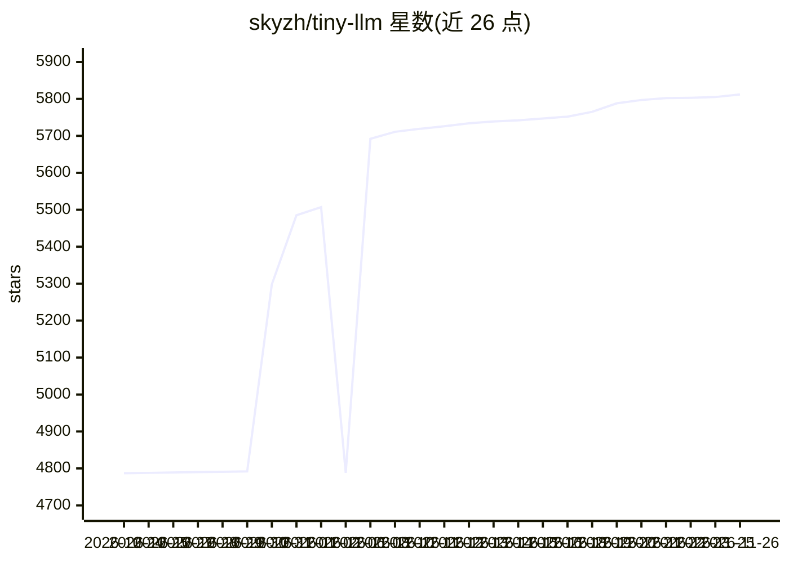

# skyzh/tiny-llm

⭐ 5,812 · Python · Apache-2.0 · 推送 2026-11-24 · [GitHub](https://github.com/skyzh/tiny-llm) · [官网](https://tiny-llm.dev) · 个人维护

**面向系统工程师在 Apple Silicon 上手写 LLM 推理系统的课程**

tiny-llm 是一个面向系统工程师的实操课程，目标是端到端理解 LLM 推理：从加载 Qwen3 模型、将 token 转为 logits 到生成文本，类比 CMU Needle 项目的 LLM serving 版本。课程按四周路径组织：基于 mlx.core 数组运算实现 Qwen3 模型、KV-cache 与量化算子、带 continuous batching 与 paged KV 的 mini vLLM 服务机制，以及编码 Agent。学员在 Python/C++/Metal 中自行实现算子，MLX 仅作正确性对照与性能基线。依赖 pdm 管理 Python 环境，教材发布于 skyzh.github.io/tiny-llm。

## 筛选速览

| 维度 | 判定 | 备注 |
|---|---|---|
| AI 角色 | `ai-knowledge` | 知识聚合/清单类 |
| 许可风险 | `permissive` | Apache-2.0 |
| 部署形态 | `None` |  |
| 模型依赖 | — | README 未给出锁定关系 |
| 硬件要求 | — | 无带数字的原话,不猜 |
| 安装摩擦 | `medium` | 含编译或系统依赖之一 |
| 成熟度 | — | 结构信号不足 |

## 能力要点

- 四周学习路径：Matmul→单请求优化→mini vLLM→编码 Agent
- 在 Python/C++/Metal 中手写算子，MLX 作正确性对照与性能基线
- 覆盖 KV-cache、量化、continuous batching、paged KV 等 serving 机制
- 基于 Apple Silicon 统一内存与 Metal 内核，无需 CUDA GPU

## 适用场景

- 系统工程师想端到端理解 LLM 推理与 serving 机制
- 在本地 Apple Silicon 环境练习实现注意力、RoPE、采样等算子
- 学习 continuous batching 与 paged KV-cache 的服务调度实现

## 场景标签

`教程课程` · 领域:学习与行业

## 证据(README 行号)

> L6: tiny-llm is a hands-on course for systems engineers who want to understand LLM
> L18: The course is built on MLX arrays and the MLX extension runtime, without using
> L26: The course follows a four-week learning path:

## 星数曲线

2026-10-24 4,787 → 2026-11-26 5,812（+1,025）

---
*卡片 v1 · prompt 1.4 · 生成 2026-11-24 · 置信度 high · 依据 README sha `1ebea08fc129` · [字段定义](../../DATASET.md)*
