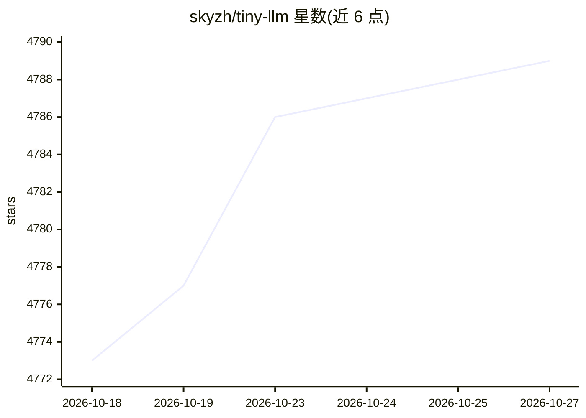

# skyzh/tiny-llm

⭐ 4,789 · Python · Apache-2.0 · 推送 2026-10-22 · [GitHub](https://github.com/skyzh/tiny-llm) · [官网](https://skyzh.github.io/tiny-llm/) · 个人维护

**面向系统工程师的 LLM 推理系统动手课程（Apple Silicon 上构建 mini vLLM）**

面向系统工程师的端到端 LLM 推理教学项目：四周路径从 MLX 数组操作手写 Qwen3 模型（attention/RoPE/GQA/RMSNorm），到 KV-cache、SIMD matmul、tiled prefill，再到连续批处理与 paged KV 的 mini vLLM，最后构建有界经验证的编码 Agent。基于 MLX 数组与扩展运行时，不使用高层神经网络层，用 Python/C++/Metal 实现算子，MLX 作为正确性基准。选择 Apple Silicon 是为在单一共享内存机器上完整检视路径，无需 CUDA GPU 环境。配套教材发布于 skyzh.github.io/tiny-llm，代码用 pdm 安装并运行测试。

## 筛选速览

| 维度 | 判定 | 备注 |
|---|---|---|
| AI 角色 | `ai-knowledge` | 知识聚合/清单类 |
| 许可风险 | `permissive` | Apache-2.0 |
| 部署形态 | `None` |  |
| 模型依赖 | — | README 未给出锁定关系 |
| 硬件要求 | — | 无带数字的原话,不猜 |
| 安装摩擦 | `medium` | 含编译或系统依赖之一 |
| 成熟度 | `idea` | |

## 能力要点

- 四周路径：手写 Qwen3 → 加速单请求 → mini vLLM（连续批处理/paged KV）→ 编码 Agent
- 基于 MLX，不调用高层算子，学生用 Python/C++/Metal 实现各算子
- Apple Silicon 共享内存 + Metal 内核，无需 CUDA GPU 即可本地运行
- 提供 tiny_llm 练习包与 tiny_llm_ref 参考解答，pdm 管理环境并有 CI 测试

## 适用场景

- 系统工程师想理解 LLM 推理从加载模型到生成文本的完整路径
- 在 Mac 本地实践 KV-cache、批处理、paged KV 等服务机制
- 按周进度学习并对照参考解答与测试验证实现

## 场景标签

`教程课程` · 领域:学习与行业

## 证据(README 行号)

> L5: tiny-llm is a hands-on course for systems engineers who want to understand LLM
> L35: - **Week 3: Build a Mini vLLM.** Introduce continuous

## 星数曲线

2026-10-18 4,773 → 2026-10-27 4,789（+16）

---
*卡片 v1 · prompt 1.4 · 生成 2026-10-20 · 置信度 high · 依据 README sha `79ff377bb661` · [字段定义](../../DATASET.md)*
