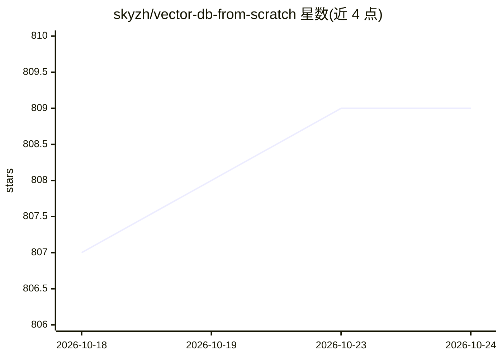

# skyzh/vector-db-from-scratch

⭐ 810 · Rust · Apache-2.0 · 推送 2026-09-16 · [GitHub](https://github.com/skyzh/vector-db-from-scratch) · [官网](https://skyzh.github.io/vector-db-from-scratch/) · 个人维护

**Rust 实战课程：从零构建内存向量数据库并接入 SQL**

面向系统与数据库工程师的动手课程：用 Rust 在六天内容中分步构建一个小型内存向量数据库，涵盖 Arrow 内存表、DataFusion 优化器规则、IVFFlat/NSW/HNSW/残差 IVF-PQ 索引、索引创建与查询计划对比的 SQL 命令，并在 SIFT1M 上共享 recall/构建时间/搜索延迟基准。课程聚焦算法到数据库特性的边界，提供入门代码、测试与完整参考实现。此前的 C++/BusTub 版本已废弃且不再维护。

## 筛选速览

| 维度 | 判定 | 备注 |
|---|---|---|
| AI 角色 | `ai-knowledge` | 知识聚合/清单类 |
| 许可风险 | `permissive` | Apache-2.0 |
| 部署形态 | `None` |  |
| 模型依赖 | — | README 未给出锁定关系 |
| 硬件要求 | — | 无带数字的原话,不猜 |
| 安装摩擦 | `low` | 无编译、无系统依赖或容器化 |
| 成熟度 | — | 结构信号不足 |

## 能力要点

- 六天渐进式 Rust 课程，每天新增一项数据库或索引能力
- 构建 IVFFlat、NSW、HNSW、残差 IVF-PQ 四类索引
- 通过 DataFusion 从 SQL 使用索引并对比查询计划
- SIFT1M 上的 recall、构建时间与搜索延迟共享基准

## 适用场景

- 系统/数据库工程师学习向量检索算法到数据库特性的实现路径
- 通过入门代码与检查点逐步完成可运行的向量数据库
- 对比近似索引与精确检索的结果差异

## 场景标签

`教程课程` `向量数据库` · 领域:知识与检索

## 证据(README 行号)

> L5: Vector Database from Scratch is a hands-on course for systems and database engineers. Build a small in-memory vector
> L25: The guided Rust course has six days. Each day adds one

## 星数曲线

2026-10-18 807 → 2026-10-24 809（+2）

---
*卡片 v1 · prompt 1.4 · 生成 2026-10-21 · 置信度 high · 依据 README sha `a2a0a5fa04ba` · [字段定义](../../DATASET.md)*
