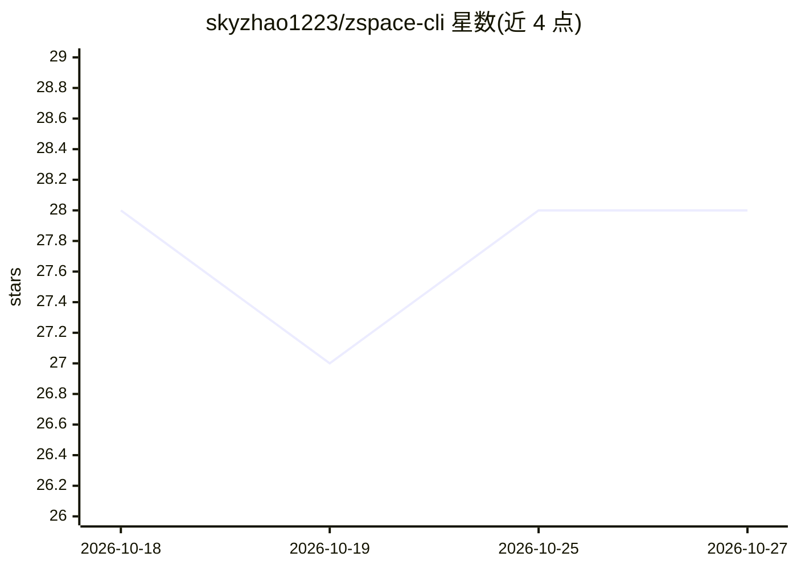

# skyzhao1223/zspace-cli

⭐ 28 · Python · MIT · 推送 2026-10-09 · [GitHub](https://github.com/skyzhao1223/zspace-cli) · [官网](https://pypi.org/project/zspace-cli/) · 个人维护 · 中文 README

**极空间 NAS 的 CLI/SDK/MCP 工具，供终端与 AI Agent 管理文件**

非官方社区维护的极空间 (ZSpace) NAS 管理工具，以 CLI、Python SDK 与 MCP server 三种形式提供，通过读取桌面客户端本地代理 (127.0.0.1:13579) 的登录状态工作，无需密码、SSH 或 DDNS。功能覆盖文件增删改查、全文搜索、大文件分片上传（带可选 MD5 校验）、下载、磁盘/SMART 诊断、存储用量统计、回收站管理与百度网盘任务读取。附带 9 个跨 NAS 的整理类 Agent Skill，以扫描→LLM 起草方案→确认→执行的只读模式运行。限制：依赖极空间桌面客户端在线且登录，其代理接口非官方文档化；Windows/Linux 配置路径为未实测的猜测。

## 筛选速览

| 维度 | 判定 | 备注 |
|---|---|---|
| AI 角色 | `ai-ecosystem` | LLM/agent 周边工具 |
| 许可风险 | `permissive` | MIT |
| 部署形态 | `self-host` | docker 或自建部署 |
| 模型依赖 | — | README 未给出锁定关系 |
| 硬件要求 | — | 无带数字的原话,不猜 |
| 安装摩擦 | `low` | 无编译、无系统依赖或容器化 |
| 成熟度 | — | 结构信号不足 |

## 能力要点

- CLI/SDK/MCP 三种形式覆盖约 20 类 NAS 操作
- 复用桌面客户端本地代理登录态，无需密码/SSH/DDDS，可在 NAT 后工作
- 9 个跨 NAS 整理 Skill：扫描→LLM 起草计划→确认后执行，删除先隔离
- 大于 64MB 文件自动走 2MB 分片上传，可选用 MD5 回环校验

## 适用场景

- 在终端用命令行管理极空间 NAS 的文件与磁盘
- 让 Claude Code/Cursor 等 Agent 通过 MCP 直接读写我的 NAS
- 用 Agent Skill 整理 NAS 上杂乱的照片、音乐与下载目录

## 场景标签

 · 领域:存储/NAS 管理工具

## 证据(README 行号)

> L10: Manage your 极空间 (ZSpace) NAS from the terminal or AI agents — **no password, no SSH, no DDNS**.
> L91: |Operation|CLI|SDK|MCP|
> L116: ## Use with AI agents (Skills)

## 星数曲线

2026-10-18 28 → 2026-10-27 28（+0）

---
*卡片 v1 · prompt 1.4 · 生成 2026-10-26 · 置信度 high · 依据 README sha `60edb6aec5b8` · [字段定义](../../DATASET.md)*
