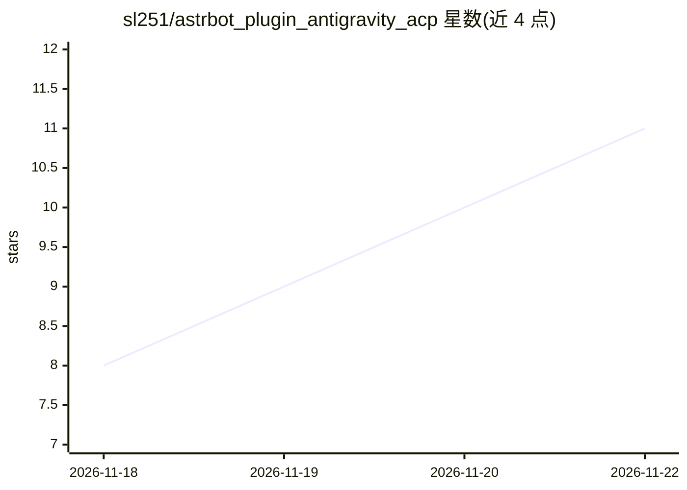

# sl251/astrbot_plugin_antigravity_acp

⭐ 11 · Python · MIT · 推送 2026-11-19 · [GitHub](https://github.com/sl251/astrbot_plugin_antigravity_acp) · 个人维护

**把 Google Antigravity 经 agy CLI 接成 AstrBot 原生 Provider 的插件**

AstrBot 插件，通过本机官方 agy 客户端的 ACP 协议（stdio 管道）将 Antigravity 模型接入 AstrBot 作为对话提供商。免 API Key 与反向代理，登录凭证由官方 CLI 管理；插件启动时强制关闭 agy 自带的本地文件与终端工具，外部工具调用交由 AstrBot 权限体系托管。支持识图、MCP 桥接工具调用、WebUI 运行监控、429 限流熔断与上下文退役机制。依赖 AstrBot >=4.29.4,<4.30 与 Python 3.11+。

## 筛选速览

| 维度 | 判定 | 备注 |
|---|---|---|
| AI 角色 | `ai-ecosystem` | LLM/agent 周边工具 |
| 许可风险 | `permissive` | MIT |
| 部署形态 | `desktop` | 安装包/桌面程序 |
| 模型依赖 | — | README 未给出锁定关系 |
| 硬件要求 | — | 无带数字的原话,不猜 |
| 安装摩擦 | `low` | 无编译、无系统依赖或容器化 |
| 成熟度 | — | 结构信号不足 |

## 能力要点

- 经官方 agy CLI 的 stdio 管道与 ACP 协议直连，免 API Key 与第三方反代
- 支持多模态识图与 MCP 桥接工具调用，工具/图片需插件与宿主双开关
- 429 快速熔断、错误提前中断与上下文退役机制
- WebUI 分层展示会话池、近 24 小时用量与上下文缓存（只读脱敏快照）

## 适用场景

- 在 AstrBot 里接入 Antigravity 模型做日常对话
- 为 QQ 机器人提供免 API Key 的模型通道
- 需要对插件运行状态和 Token 用量做只读监控

## 场景标签

`聊天机器人` · 领域:对话与助手

## 证据(README 行号)

> L10: 通过 Google 官方 `agy` 客户端内置的 ACP（Agent Client Protocol）协议，把 Antigravity 模型安全、稳定地接入 AstrBot，作为日常对话主力。
> L76: 之后想换模型，用 `/agy use <provider_id>`，或直接在 AstrBot 的提供商列表里切换。纯聊天建议在首次设置中选 `chat` 角色，避免工具 schema 额外占用上下文空间。

## 星数曲线

2026-11-18 8 → 2026-11-22 11（+3）

---
*卡片 v1 · prompt 1.4 · 生成 2026-11-20 · 置信度 high · 依据 README sha `d3c2117b8149` · [字段定义](../../DATASET.md)*
