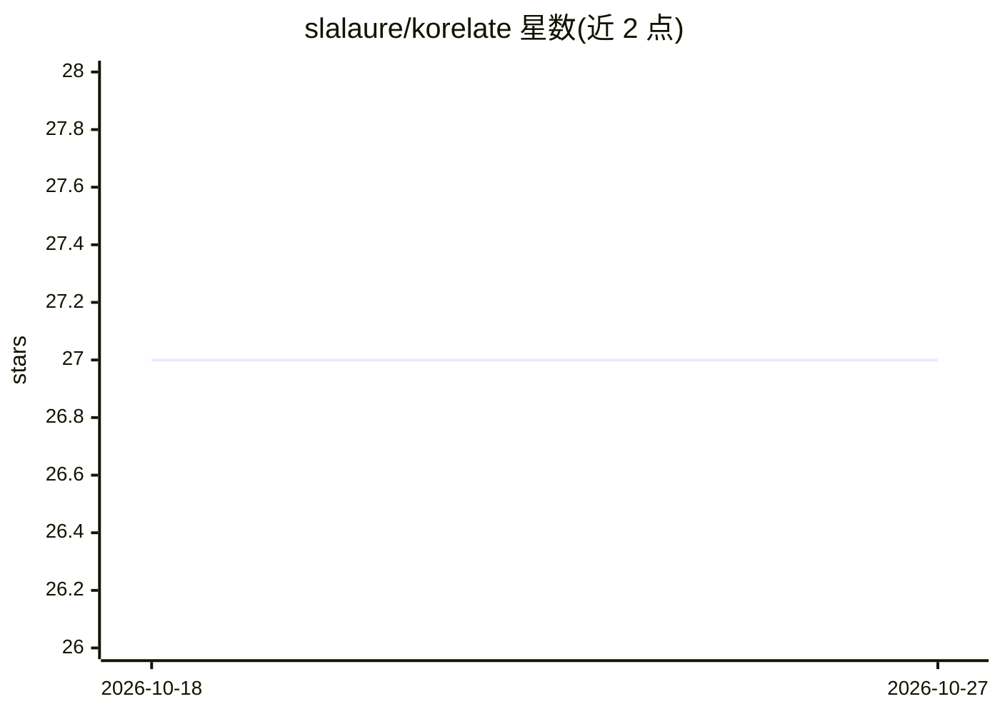

# slalaure/korelate

⭐ 27 · JavaScript · Apache-2.0 · 推送 2026-05-27 · [GitHub](https://github.com/slalaure/korelate) · [官网](https://www.mqttunsviewer.com) · 个人维护

**面向工业 UNS 的开源运维中心，集成自主 AI Agent**

部署在边缘侧的统一命名空间（UNS）运维中心：通过 MQTT/Sparkplug B、OPC UA、Modbus、S7、BACnet 等协议接入工业数据，可视化主题树、构建动态 SVG/3D HMI 仪表盘，用沙箱 JavaScript ETL 规范化数据，DuckDB 做本地时序存储、TimescaleDB 为可选长期归档。内嵌自主 AI Agent 监控告警、调查根因并生成报告，另有 AI 聊天助手（多模型）与 MCP 端点。面向工业自动化/IIoT 场景，通过 Docker Compose 部署。

## 筛选速览

| 维度 | 判定 | 备注 |
|---|---|---|
| AI 角色 | `ai-enhanced` | 去掉 AI 部分产品仍成立 |
| 许可风险 | `permissive` | Apache-2.0 |
| 部署形态 | `self-host` | docker 或自建部署 |
| 模型依赖 | — | README 未给出锁定关系 |
| 硬件要求 | — | 无带数字的原话,不猜 |
| 安装摩擦 | `low` | 无编译、无系统依赖或容器化 |
| 成熟度 | — | 结构信号不足 |

## 能力要点

- MQTT/Sparkplug B、OPC UA、Modbus、S7、EtherNet/IP、BACnet、Kafka 等多协议南向接入
- 三层存储：内存实时广播 + DuckDB 本地 OLAP + 可选 TimescaleDB 归档，带限速与反压机制
- 沙箱 JavaScript Mapper（ETL）将原始载荷规范化为 UNS 结构
- 内嵌自主 AI Agent：告警监控、根因调查、报告生成，提供 MCP 端点

## 适用场景

- 把散落在多个 broker/PLC 的工业数据统一为 UNS 结构并可视化
- 构建带实时数据绑定的 SVG/3D 数字孪生 HMI 仪表盘
- 让 AI Agent 监控工业告警、分析根因并自动生成报告
- 对历史时序数据做时间旅行查询与导出分析

## 场景标签

`聊天机器人` `数据分析` · 领域:效率与自动化

## 证据(README 行号)

> L36: 4. **Analyze** with the **Autonomous AI Agent** which monitors alerts, investigates root causes using available too
> L70: Korelate acts as a high-performance protocol gateway, bringing data from various industrial and IT sources into a u

## 星数曲线

2026-10-18 27 → 2026-10-27 27（+0）

---
*卡片 v1 · prompt 1.4 · 生成 2026-10-26 · 置信度 mid · 依据 README sha `fc9c042ed17a` · [字段定义](../../DATASET.md)*
