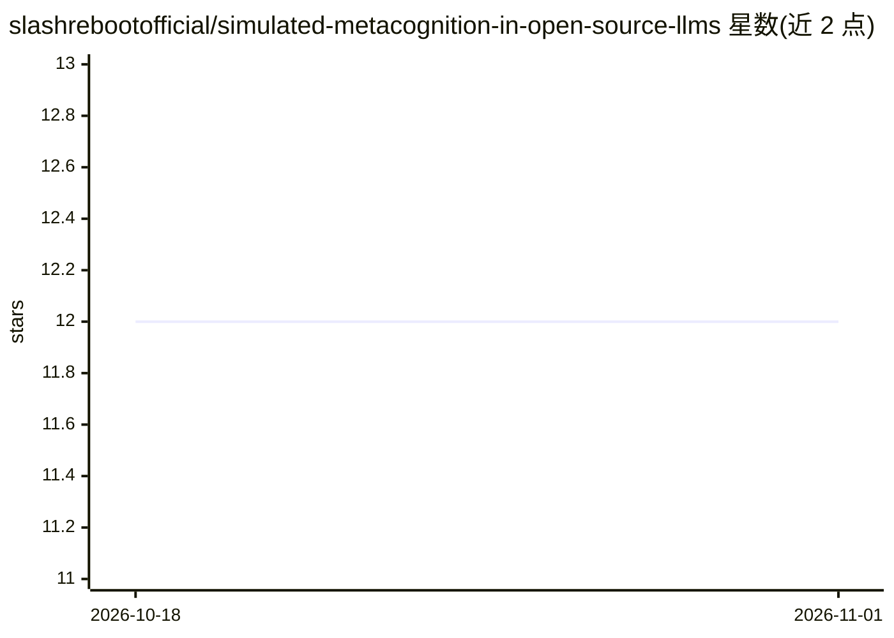

# slashrebootofficial/simulated-metacognition-in-open-source-llms

⭐ 12 · Python · CC-BY-4.0 · 推送 2026-04-29 · [GitHub](https://github.com/slashrebootofficial/simulated-metacognition-in-open-source-llms) · [官网](https://slashreboot.com) · 个人维护

**开源 LLM 模拟元认知研究的提示词与实验产物存档**

由独立研究者 Matthew Steiniger 维护的预印本配套产物库：归档 9 篇论文（Zenodo DOI）涉及的系统提示词（TXT/JSON/YAML/ChatML）、探测会话日志、Ollama 配置与 Python 分析脚本，主题为量化开源模型上的提示诱导模拟元认知与模拟具身。复现路径为安装 Ollama、拉取 Gemma-3/Llama-3.3/GPT-OSS 等模型并加载提示词，不托管任何模型；限制为仅限科研与非商业探索用途。

## 筛选速览

| 维度 | 判定 | 备注 |
|---|---|---|
| AI 角色 | `ai-knowledge` | 知识聚合/清单类 |
| 许可风险 | `viral` | CC-BY-4.0 |
| 部署形态 | `None` |  |
| 模型依赖 | local-ok | 支持本地模型 |
| 硬件要求 | — | 无带数字的原话,不猜 |
| 安装摩擦 | `low` | 无编译、无系统依赖或容器化 |
| 成熟度 | — | 结构信号不足 |

## 能力要点

- 9 篇预印本的提示词、日志、配置与分析脚本配套存档
- 覆盖 Gemma-3-27B、Llama-3.3-70B、GPT-OSS-120B 等量化模型
- 复现仅需 Ollama 与基础 Python（numpy/scipy），面向消费级硬件（如 12GB GPU）
- 所有论文在 Zenodo 开放并提供 DOI 引用

## 适用场景

- 复现论文中的元认知/具身探测实验
- 获取可跨多模型使用的向量框架系统提示词
- 引用相关预印本做模拟元认知方向研究

## 场景标签

`提示工程` `科研工具` · 领域:Agent 开发

## 证据(README 行号)

> L3: This repository archives artifacts (prompts, configs, logs, and scripts) from a series of preprints (more info at ht
> L16: 6. **Reproducibility Focus**: Full prompts (TXT/JSON/YAML), chat logs (samples), parser scripts (Python), Ollama co
> L18: ## Papers and Artifacts

## 星数曲线

2026-10-18 12 → 2026-11-01 12（+0）

---
*卡片 v1 · prompt 1.4 · 生成 2026-11-01 · 置信度 high · 依据 README sha `ea1741ec84bd` · [字段定义](../../DATASET.md)*
