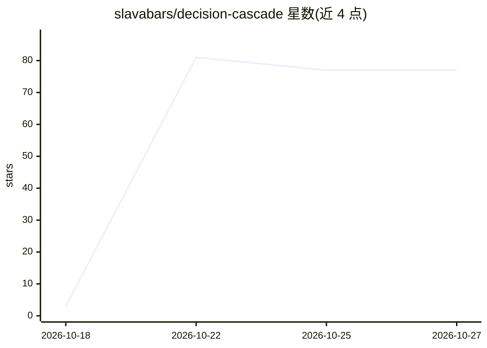

# slavabars/decision-cascade

⭐ 77 · Python · Apache-2.0 · 推送 2026-10-18 · [GitHub](https://github.com/slavabars/decision-cascade) · 个人维护

**本地决策引擎：输出类型化、可校准的概率决策而非文本生成**

面向开发者的本地决策服务：将状态编码为特征，由决策头返回类型化、可校准的概率输出——Noul（是/否）、Choice（选项）、Score（量表），无自回归生成。覆盖训练（SFT）→RLCD 校准→ECE/Brier 评估→延迟剖析→部署的完整流程，以 FastAPI 服务（/v1/systemone 协议）+ Python SDK 形式提供。支持从 hash 编码器（离线）、gpt2（CPU）到 gemma-4-12B（GPU）的模型选择，可级联'便宜→强'的 escalation，也可代理到外部 SystemOne 兼容服务（vLLM/SGLang 部署的 Clef-Flash 等）。README 自述为开放 beta，开箱头部为随机初始化，需自行标注数据或下载权重包。

## 筛选速览

| 维度 | 判定 | 备注 |
|---|---|---|
| AI 角色 | `ai-native` | 本体是模型或模型工具 |
| 许可风险 | `permissive` | Apache-2.0 |
| 部署形态 | `library` | 以包/库形式分发 |
| 模型依赖 | local-ok | 支持本地模型 |
| 硬件要求 | — | 无带数字的原话,不猜 |
| 安装摩擦 | `medium` | 含编译或系统依赖之一 |
| 成熟度 | `idea` | |

## 能力要点

- Noul/Choice/Score 类型化输出，附 confidence 与版本化 schema
- 内置 ECE/Brier 校准指标与 RLCD 校准训练路径
- 级联 escalation（置信度阈值/风险预算）+ 外部 SystemOne 后端代理
- 多模型后端：hash/gpt2(CPU)/gemma-4-12B(GPU)，CLIP/SigLIP 图像输入

## 适用场景

- 在自有服务器上以校准概率输出替代 LLM 文本决策
- 对'便宜→强'模型做级联路由并按置信度升级
- 与 SystemOne 协议生态（Clef/Perplexity Decider）互操作或代理

## 场景标签

`推理引擎` `模型网关` · 领域:Agent 开发

## 证据(README 行号)

> L7: Вместо того чтобы заставлять LLM генерировать текст ответа, модель **решает**:
> L9: **типизированные, вероятностные и калибруемые** ответы — Noul (да/нет),
> L25: ```

## 星数曲线



2026-10-18 3 → 2026-10-27 77（+74）


---
*卡片 v1 · prompt 1.4 · 生成 2026-10-24 · 置信度 high · 依据 README sha `402e8ee5c18c` · [字段定义](../../DATASET.md)*
