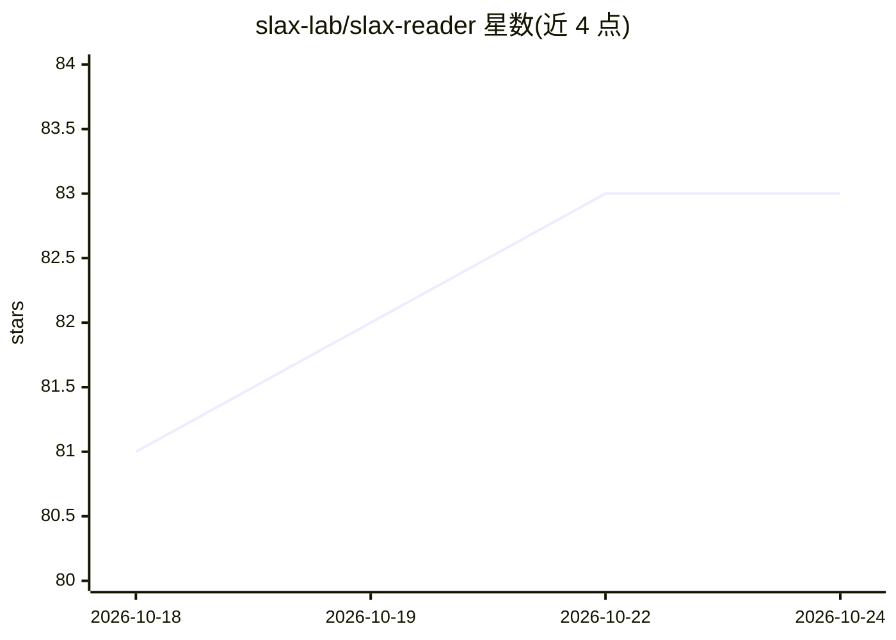

# slax-lab/slax-reader

⭐ 83 · TypeScript · Apache-2.0 · 推送 2026-10-23 · [GitHub](https://github.com/slax-lab/slax-reader) · [官网](https://slax.com/reader/) · 组织维护 · 中文 README

**开源自托管的稍后读应用，网页存档+标注讨论+AI阅读辅助**

Slax Reader 是一个 read-it-later 类阅读应用：保存网页生成永久快照、划线高亮标注并生成可分享讨论链接。AI 作为阅读辅助提供大纲、摘要与上下文问答。Monorepo 包含 Web 前端、Chrome/Edge 浏览器扩展、运行于 Cloudflare Workers 的 API（Core/Edge/AI/Browser）、CLI 及共享包。提供官方 Web/iOS/Android/Chrome 客户端，可自托管，开发依赖 Node.js/pnpm，CLI 经 npm 发布。Apache 2.0 许可。

## 筛选速览

| 维度 | 判定 | 备注 |
|---|---|---|
| AI 角色 | `ai-enhanced` | 去掉 AI 部分产品仍成立 |
| 许可风险 | `permissive` | Apache-2.0 |
| 部署形态 | `library` | 以包/库形式分发 |
| 模型依赖 | — | README 未给出锁定关系 |
| 硬件要求 | — | 无带数字的原话,不猜 |
| 安装摩擦 | `low` | 无编译、无系统依赖或容器化 |
| 成熟度 | — | 结构信号不足 |

## 能力要点

- 保存网页生成永久快照，原链接失效后仍可读
- AI 阅读辅助：大纲、摘要与上下文问答
- 任意段落标注并分享链接，他人可加入讨论
- API 运行于 Cloudflare Workers，提供 CLI（@slax-lab/reader-cli）

## 适用场景

- 收藏网页稍后阅读并保留永久存档
- 阅读时用 AI 获取摘要、大纲和针对原文的问答
- 对文章做高亮批注并邀请他人讨论

## 场景标签

`文档问答` · 领域:知识与检索

## 证据(README 行号)

> L3: Open-source, AI-powered read-it-later — save web pages, highlight, and discuss.
> L20: - **AI reading aids** — outlines, summaries, and in-context answers while you read.

## 星数曲线

2026-10-18 81 → 2026-10-24 83（+2）

---
*卡片 v1 · prompt 1.4 · 生成 2026-10-24 · 置信度 mid · 依据 README sha `8d526b51ddac` · [字段定义](../../DATASET.md)*
