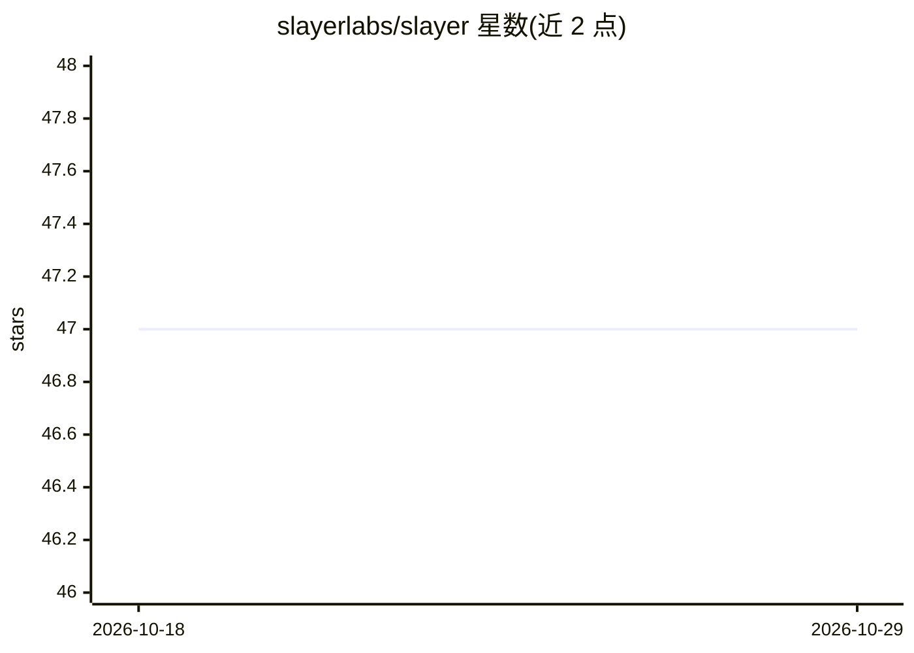

# slayerlabs/slayer

⭐ 47 · JavaScript · MIT · 推送 2026-10-26 · [GitHub](https://github.com/slayerlabs/slayer) · [官网](https://slayer.fabryka.ai/) · 组织维护

**波兰语 LLM 实验室：低成本微调 Qwen 基座做波兰语专用模型**

开源实验室项目，目标是基于 Qwen3.5-9B（Apache 2.0）以约 1.5–2 万兹罗提算力，通过 QLoRA SFT 与 GRPO/RLVR 训练面向波兰法律/行政场景的 11–14B 模型，与 Bielik-11B-v3 作为基准对照。提供评测 harness（MCQ、PoQuAD、FLORES、GSM8K）、9 项基准的 Phase 0 实测数据、leaderboard 网站与训练方法文档；要求 ollama 与 Python 3.10+，pip 可安装。承诺评测集不进训练、语料去污染。

## 筛选速览

| 维度 | 判定 | 备注 |
|---|---|---|
| AI 角色 | `ai-ecosystem` | LLM/agent 周边工具 |
| 许可风险 | `permissive` | MIT |
| 部署形态 | `library` | 以包/库形式分发 |
| 模型依赖 | local-ok | 支持本地模型 |
| 硬件要求 | — | 无带数字的原话,不猜 |
| 安装摩擦 | `low` | 无编译、无系统依赖或容器化 |
| 成熟度 | `idea` | |

## 能力要点

- 基于 Qwen3.5-9B 的 QLoRA SFT + GRPO/RLVR 波兰语专用化训练路线
- 评测 harness 覆盖 MCQ/PoQuAD+judge/FLORES/GSM8K，含 dashboard
- Bielik-11B-v3 与 Qwen3.5-9B 的 9 项基准对照数据
- 评测集仅用于测量、训练语料做去污染的方法学声明

## 适用场景

- 跟踪波兰语模型的低成本训练实验与结果
- 复现基准评测流程，对比波兰语 LLM 表现
- 参与波兰法律/行政语料与评测贡献

## 场景标签

`微调` `强化学习` `模型评测` · 领域:评测与运维

## 证据(README 行号)

> L41: Nasza teza „super tanio + epsilon": **startujemy z Qwen3.5-9B** (bije Bielika 8:1 wg leaderboardu) → **pomijamy naj
> L61: bench/        harness ewaluacyjny (MCQ, PoQuAD+judge, FLORES, GSM8K), orkiestrator, dashboard

## 星数曲线

2026-10-18 47 → 2026-10-29 47（+0）

---
*卡片 v1 · prompt 1.4 · 生成 2026-10-25 · 置信度 high · 依据 README sha `c37c27c8702f` · [字段定义](../../DATASET.md)*
