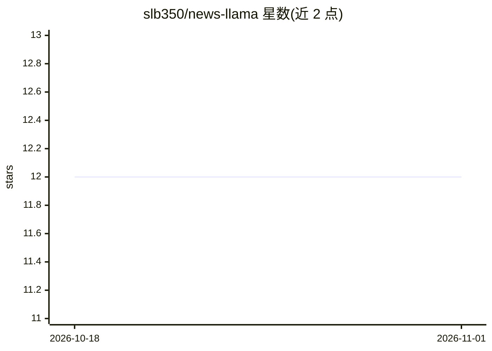

# slb350/news-llama

⭐ 12 · Python · MIT · 推送 2026-10-12 · [GitHub](https://github.com/slb350/news-llama) · 个人维护

**本地 LLM 驱动的个性化新闻聚合与日报生成引擎**

从 RSS、Reddit 和 DuckDuckGo 网络搜索聚合内容，基于用户兴趣用五级递进式 AI 来源发现（预定义模式、LLM 子版块匹配、宽泛发现、精确匹配、Reddit 搜索）寻找信源，再经本地 LLM（open-agent-sdk、OpenAI 兼容 API）做摘要与情绪分析，预过滤机制减少约 90% 的 LLM 处理时间。输出 HTML/JSON/RSS 日报。提供 CLI、FastAPI+SQLite 多用户 Web 应用及 SwiftUI macOS 原生客户端。Twitter/X 聚合器为未实现的占位符。

## 筛选速览

| 维度 | 判定 | 备注 |
|---|---|---|
| AI 角色 | `ai-native` | 本体是模型或模型工具 |
| 许可风险 | `permissive` | MIT |
| 部署形态 | `library` | 以包/库形式分发 |
| 模型依赖 | — | README 未给出锁定关系 |
| 硬件要求 | — | 无带数字的原话,不猜 |
| 安装摩擦 | `low` | 无编译、无系统依赖或容器化 |
| 成熟度 | — | 结构信号不足 |

## 能力要点

- 五级递进式 AI 来源发现策略（预定义/LLM 匹配/宽泛发现/精确匹配/Reddit 搜索）
- 本地 LLM 摘要 + 预过滤（README 给出约 90% LLM 时间减少示例）
- 多用户 Web 应用：兴趣管理、日报日历、后台定时生成（APScheduler）
- SwiftUI macOS 原生客户端消费 /api/v1 JSON API

## 适用场景

- 按个人兴趣生成每日新闻摘要日报
- 本地运行保护阅读习惯隐私
- 多家庭成员各自维护兴趣订阅并定时收到个性化 newsletter

## 场景标签

`网页抓取` `AI 写作` · 领域:效率与自动化

## 证据(README 行号)

> L3: AI-powered news curation engine that aggregates content from RSS, Reddit, and web search (DuckDuckGo), then summariz
> L17: - **AI Summarization**: Local LLM-powered summarization via open-agent-sdk

## 星数曲线

2026-10-18 12 → 2026-11-01 12（+0）

---
*卡片 v1 · prompt 1.4 · 生成 2026-11-01 · 置信度 high · 依据 README sha `1c08b8e34107` · [字段定义](../../DATASET.md)*
