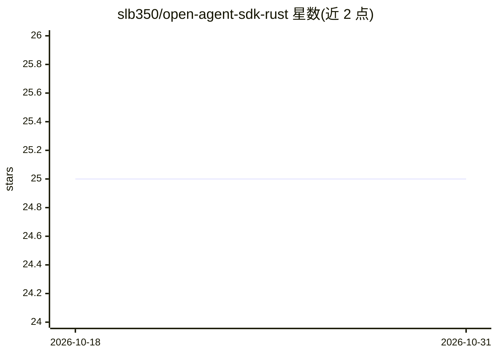

# slb350/open-agent-sdk-rust

⭐ 25 · Rust · MIT · 推送 2026-10-28 · [GitHub](https://github.com/slb350/open-agent-sdk-rust) · 个人维护

**Rust AI agent SDK：经 OpenAI/Anthropic 协议接入本地或云端模型**

一个 Rust crate（open-agent-sdk），用于构建 AI agent：通过 OpenAI chat completions 或 Anthropic messages 两种协议访问本地（LM Studio、Ollama、llama.cpp、vLLM）与云端（OpenAI、Anthropic、OpenRouter、Azure OpenAI 等）模型服务。提供 SSE 容错流式输出、FinishReason 终止原因报告、工具调用聚合与自动执行、生命周期钩子、重试逻辑与自定义请求头。限制：不直接支持 Bedrock、Vertex 等 SDK-only API（需经兼容网关）。

## 筛选速览

| 维度 | 判定 | 备注 |
|---|---|---|
| AI 角色 | `ai-ecosystem` | LLM/agent 周边工具 |
| 许可风险 | `permissive` | MIT |
| 部署形态 | `library` | 以包/库形式分发 |
| 模型依赖 | local-ok | 支持本地模型 |
| 硬件要求 | — | 无带数字的原话,不猜 |
| 安装摩擦 | `low` | 无编译、无系统依赖或容器化 |
| 成熟度 | — | 结构信号不足 |

## 能力要点

- 双协议支持：OpenAI chat completions 与 Anthropic messages，按端点选择
- SSE 跨传输块缓冲，容忍无 finish_reason 关闭连接的服务器（llama.cpp/vLLM 等）
- 每个流以唯一 Finish 事件携带终止原因（Length/Stop/Unspecified）
- 工具调用聚合与自动执行、重试逻辑、推理内容单独路由

## 适用场景

- 在 Rust 项目中对接本地 LM Studio/Ollama/llama.cpp 构建无 API 成本的 agent
- 构建带函数调用的多轮对话 agent 或代码审查、数据分析工具
- 同一套代码在本地与云端模型服务之间切换

## 场景标签

`Agent 框架` · 领域:Agent 开发

## 证据(README 行号)

> L3: > Build AI agents in Rust, over OpenAI chat completions or Anthropic messages
> L24: Open Agent SDK (Rust) provides a clean, streaming API for working with local and cloud model servers over two wire 
> L38: ## Supported Providers

## 星数曲线

2026-10-18 25 → 2026-10-31 25（+0）

---
*卡片 v1 · prompt 1.4 · 生成 2026-10-26 · 置信度 high · 依据 README sha `a15fc99cf992` · [字段定义](../../DATASET.md)*
