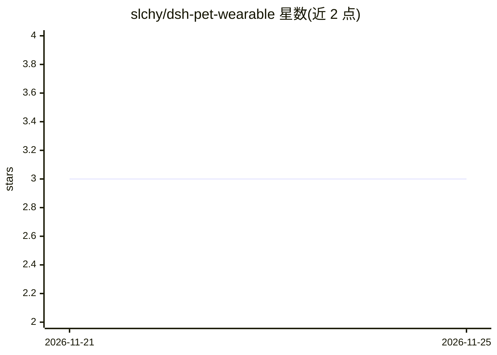

# slchy/dsh-pet-wearable

⭐ 3 · TypeScript · MIT · 推送 2026-11-22 · [GitHub](https://github.com/slchy/dsh-pet-wearable) · 个人维护 · 中文 README

**面向智能穿戴设备的云端全双工语音伴生 Agent**

以 Node.js/TypeScript 实现的云端语音 Agent 服务端：端侧设备仅上传音频与传感器帧，云端提供流式 ASR、语义判停、LLM 推理与流式 TTS 全链路。机制上采用快慢双轨投机推理（快模型直答短句、复杂任务转交 dsh 深度推理）、毫秒级 Barge-in 打断、基于佩戴/电量/时段状态机的受控主动开口，以及 6 下行操作/6 上行事件的标准设备能力协商协议。内置零密钥 Mock 组件与虚拟时间模拟器，支持独立进程与 dsh(Cordis) 插件两种部署形态，标注为实验状态。

## 筛选速览

| 维度 | 判定 | 备注 |
|---|---|---|
| AI 角色 | `ai-native` | 本体是模型或模型工具 |
| 许可风险 | `permissive` | MIT |
| 部署形态 | `library` | 以包/库形式分发 |
| 模型依赖 | locked-api |  |
| 硬件要求 | — | 无带数字的原话,不猜 |
| 安装摩擦 | `low` | 无编译、无系统依赖或容器化 |
| 成熟度 | `idea` | |

## 能力要点

- 快慢双轨投机推理：短句快模型直答 p50 920–1054 ms，复杂任务转交 dsh
- 全双工免唤醒：能量门 + TurnJudge 语义判停，用户开口即 Barge-in 打断并取消在途推理
- 硬件解耦：Hello 握手动态协商设备能力，接入新硬件不改核心代码
- 内置 canned 识别、silent 合成、echo 代理与虚拟时间模拟器，零密钥本地跑通

## 适用场景

- 给智能眼镜/耳机等穿戴设备接入免唤醒全双工语音对话
- 为全天候佩戴场景构建低功耗的云端语音伴生助手
- 验证语音 Agent 的打断、判停与主动开口时序策略

## 场景标签

`语音 Agent` · 领域:对话与助手

## 证据(README 行号)

> L9: **面向智能穿戴设备的云端全双工语音伴生 Agent（基于 `dsh` / DeepSeek Harness）**
> L33: - ⚡ **快慢双轨投机推理（Fast Lane + dsh）**
> L38: - 🎙️ **真正的全双工与自然打断（Full-Duplex & Barge-In）**

## 星数曲线

2026-11-21 3 → 2026-11-25 3（+0）

---
*卡片 v1 · prompt 1.4 · 生成 2026-11-21 · 置信度 mid · 依据 README sha `3709a9ff56f9` · [字段定义](../../DATASET.md)*
