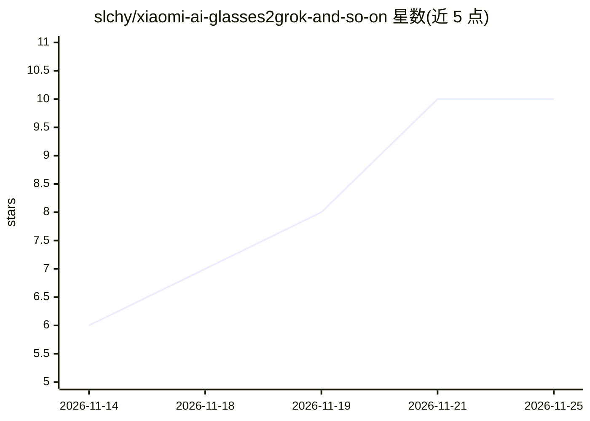

# slchy/xiaomi-ai-glasses2grok-and-so-on

⭐ 10 · Kotlin · NOASSERTION · 推送 2026-11-17 · [GitHub](https://github.com/slchy/xiaomi-ai-glasses2grok-and-so-on) · [官网](https://moe.st/blog/essays/xiaomi-ai-glasses/) · 个人维护 · 中文 README

**小米 AI 眼镜的第三方蓝牙协议解析与 Android SDK，接入任意大模型**

面向小米 AI 眼镜（M2442G1）的第三方项目，提供三部分内容：蓝牙 SPP 通信协议解析（L1 帧格式、滑动窗口、SAR 状态机）、分 7 模块的 Android SDK（发布 AAR 供 Gradle 接入）及演示 App（伴随/直播/相册/设置四页）。云端语音后端（mSBC 解码→判停→ASR→Agent→TTS）已拆分至独立仓库 dsh-pet-wearable，本仓只保留设备侧。面向想自定义眼镜语音助手的开发者，采用非商业许可。

## 筛选速览

| 维度 | 判定 | 备注 |
|---|---|---|
| AI 角色 | `ai-ecosystem` | LLM/agent 周边工具 |
| 许可风险 | `none` | NOASSERTION |
| 部署形态 | `None` |  |
| 模型依赖 | — | README 未给出锁定关系 |
| 硬件要求 | — | 无带数字的原话,不猜 |
| 安装摩擦 | `medium` | 含编译或系统依赖之一 |
| 成熟度 | — | 结构信号不足 |

## 能力要点

- 蓝牙 SPP 协议解析，含形式化规范与能力矩阵文档（58 项能力）
- Android SDK 分 7 模块，通过 mavenLocal 发布 AAR 接入
- 演示 App 支持第一人称 RTMP 推流与 Wi-Fi Direct 相册同步
- 提供无第三方依赖的 Python 帧解析参考实现

## 适用场景

- 为小米 AI 眼镜开发自定义语音助手并接入自选大模型
- 调试眼镜的语音、手势、相册与网络命令协议
- 第一人称视角 RTMP 直播推流

## 场景标签

`语音 Agent` · 领域:对话与助手

## 证据(README 行号)

> L12: 针对小米 AI 智能眼镜（型号 M2442G1）的第三方蓝牙 SPP 通信协议解析、Android SDK 与云端语音后端，可接入任意大模型，做成自定义语音助手。
> L47: ## Android SDK
> L44: - **自建云端语音后端**：已拆成独立仓库 `dsh-pet-wearable`（mSBC 解码 → 判停 → ASR → Agent → TTS）。

## 星数曲线

2026-11-14 6 → 2026-11-25 10（+4）

---
*卡片 v1 · prompt 1.4 · 生成 2026-11-20 · 置信度 high · 依据 README sha `19aecc30a92c` · [字段定义](../../DATASET.md)*
