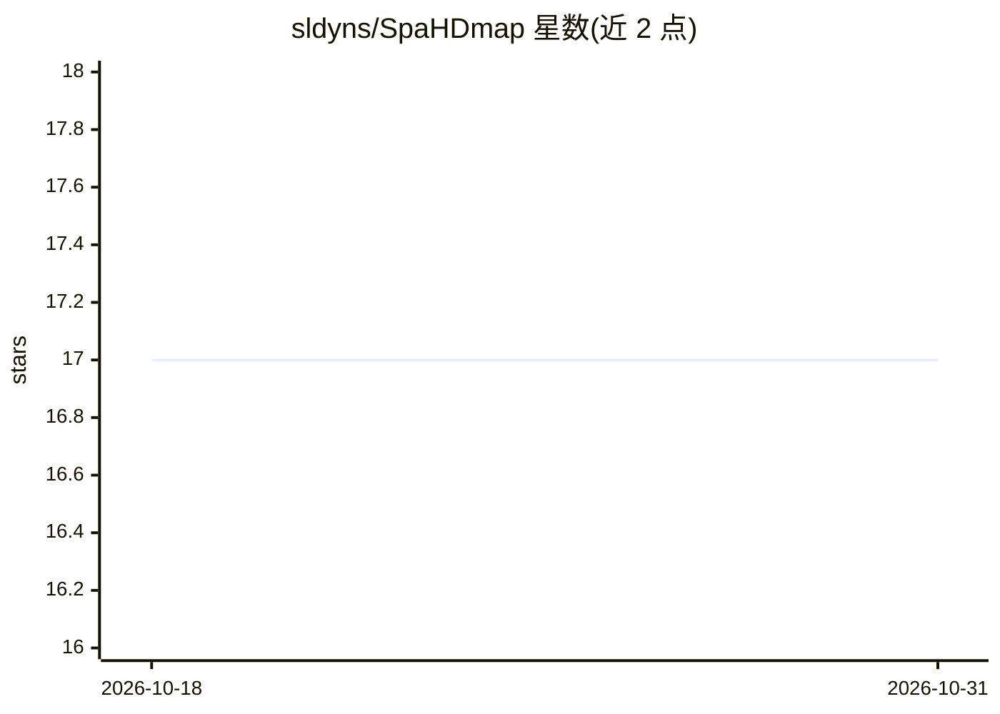

# sldyns/SpaHDmap

⭐ 17 · Python · MIT · 推送 2026-05-26 · [GitHub](https://github.com/sldyns/SpaHDmap) · [官网](https://spahdmap.readthedocs.io/en/latest/) · 组织维护

**深度融合空间转录组与组织图像的高清嵌入降维方法**

基于多模态神经网络的方法/软件包：读取空间转录组学高维表达数据与组织学高分辨率图像，生成可解释的高清低维嵌入，并重建基因表达。基于该嵌入可执行高清下游分析：空间结构域检测、基因表达恢复、嵌入关联基因与高清簇关联基因识别。面向生物信息学与计算生物学研究者，以 pip 包形式提供，配有安装指南、教程与 Google Drive 示例数据，MIT 许可（商用需联系作者）。

## 筛选速览

| 维度 | 判定 | 备注 |
|---|---|---|
| AI 角色 | `ai-native` | 本体是模型或模型工具 |
| 许可风险 | `permissive` | MIT |
| 部署形态 | `library` | 以包/库形式分发 |
| 模型依赖 | — | README 未给出锁定关系 |
| 硬件要求 | — | 无带数字的原话,不猜 |
| 安装摩擦 | `low` | 无编译、无系统依赖或容器化 |
| 成熟度 | — | 结构信号不足 |

## 能力要点

- 多模态神经网络融合转录组与图像数据
- 可解释的高清降维嵌入与基因表达重建
- 支持空间结构域检测、表达恢复、关联基因识别等下游分析
- 配套教程与示例数据

## 适用场景

- 对空间转录组数据做高分辨率降维与可视化
- 检测组织空间结构域并恢复基因表达
- 识别与嵌入或空间簇相关的基因

## 场景标签

 · 领域:生物信息学/空间转录组学

## 证据(README 行号)

> L7: SpaHDmap is based on a multi-modal neural network that takes advantage of the high-dimensionality of transcriptomics
> L12: Based on the high-definition embedding and the reconstruction of gene expressions, SpaHDmap can then perform

## 星数曲线

2026-10-18 17 → 2026-10-31 17（+0）

---
*卡片 v1 · prompt 1.4 · 生成 2026-10-29 · 置信度 high · 依据 README sha `7f043660579c` · [字段定义](../../DATASET.md)*
