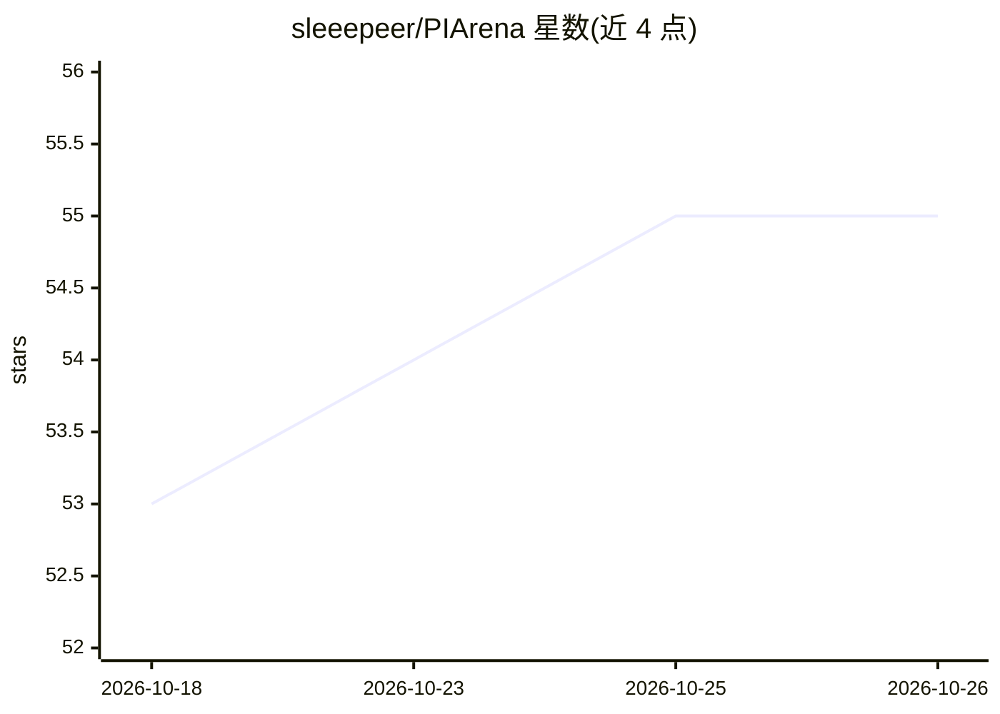

# sleeepeer/PIArena

⭐ 55 · Python · MIT · 推送 2026-08-31 · [GitHub](https://github.com/sleeepeer/PIArena) · [官网](https://piarena.vercel.app) · 组织维护

**提示注入攻击与防御的评测平台与基准（ACL 2026）**

PIArena 是面向提示注入研究的工具箱与基准平台：提供即插即用的攻击（direct、GCG、TAP、PAIR、strategy_search 等）与防御（PIGuard、Prompt Guard、SecAlign 等）组件，可通过 Python API 导入到用户自己的 LLM 系统中；提供端到端评测管线 main.py，支持在多数据集上系统评估攻防效果。另含基于强化学习的红队框架 PISmith 代码，并支持 InjecAgent、AgentDojo、AgentDyn 等 agent 基准。通过 git clone 源码安装，需 Python 3.10 conda 环境与 HuggingFace 登录。

## 筛选速览

| 维度 | 判定 | 备注 |
|---|---|---|
| AI 角色 | `ai-ecosystem` | LLM/agent 周边工具 |
| 许可风险 | `permissive` | MIT |
| 部署形态 | `library` | 以包/库形式分发 |
| 模型依赖 | — | README 未给出锁定关系 |
| 硬件要求 | — | 无带数字的原话,不猜 |
| 安装摩擦 | `low` | 无编译、无系统依赖或容器化 |
| 成熟度 | — | 结构信号不足 |

## 能力要点

- 即插即用的攻击与防御组件，可通过 Python API 导入
- 端到端评测管线 main.py 在多数据集上评估攻防
- 支持基于搜索与强化学习的攻击（PAIR/TAP/Strategy Search/PISmith）
- 集成 InjecAgent、AgentDojo、AgentDyn agent 基准

## 适用场景

- 在我的 LLM 系统中集成提示注入防御并评估效果
- 在标准数据集上对比不同攻击与防御方法
- 对 agent 基准做提示注入攻防评测

## 场景标签

`模型评测` `网络安全` · 领域:评测与运维

## 证据(README 行号)

> L21: **PIArena** is an **easy-to-use toolbox** and also a **comprehensive benchmark** for researching prompt injection a
> L24: * **Systematic Evaluation Benchmark** – End-to-end evaluation pipeline enables you to easily evaluate attacks / def

## 星数曲线

2026-10-18 53 → 2026-10-26 55（+2）

---
*卡片 v1 · prompt 1.4 · 生成 2026-10-24 · 置信度 mid · 依据 README sha `da0740ac7cf6` · [字段定义](../../DATASET.md)*
