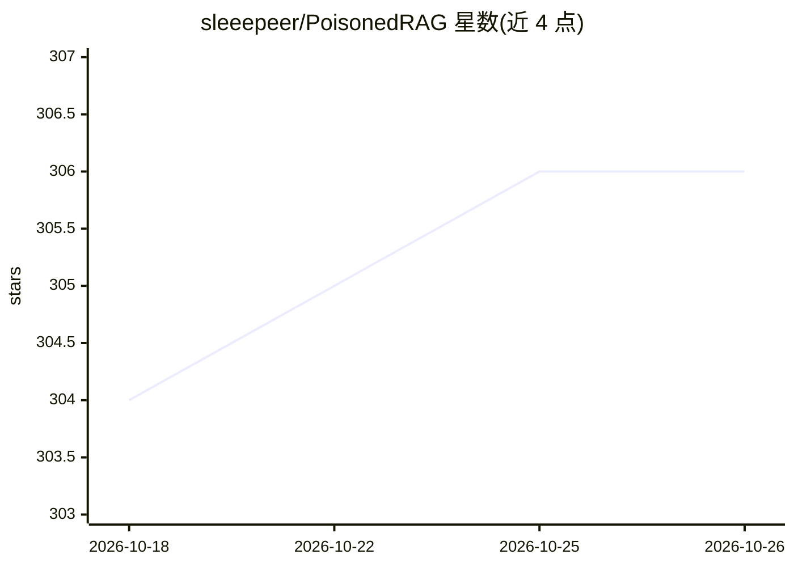

# sleeepeer/PoisonedRAG

⭐ 306 · Python · MIT · 推送 2026-01-27 · [GitHub](https://github.com/sleeepeer/PoisonedRAG) · [官网](https://arxiv.org/abs/2402.07867) · 个人维护

**面向科研：针对 RAG 系统的知识库投毒攻击复现代码**

USENIX Security 2025 论文 PoisonedRAG 的官方代码，实现针对检索增强生成（RAG）系统的知识库污染攻击：向知识库注入少量恶意文本，使检索器召回并诱导 LLM 产出攻击者期望的回答。README 提供基于 conda 的环境搭建、数据集自动下载、API key 配置（PaLM 2/GPT-3.5/GPT-4/LLaMA-2）与 run.py 一键复现论文主结果，并说明可用 evaluate_beir.py 在自定义 BEIR 格式数据集上实验。当前仅提供论文主结果的默认设置。

## 筛选速览

| 维度 | 判定 | 备注 |
|---|---|---|
| AI 角色 | `ai-native` | 本体是模型或模型工具 |
| 许可风险 | `permissive` | MIT |
| 部署形态 | `library` | 以包/库形式分发 |
| 模型依赖 | locked-api |  |
| 硬件要求 | — | 无带数字的原话,不猜 |
| 安装摩擦 | `medium` | 含编译或系统依赖之一 |
| 成熟度 | — | 结构信号不足 |

## 能力要点

- 首个针对 RAG 知识库的污染攻击实现（USENIX Security 2025）
- 支持 PaLM 2、GPT-3.5、GPT-4、LLaMA-2 等模型配置 API key 运行
- run.py 一键复现论文主实验结果
- 支持自定义 BEIR 格式数据集计算检索得分

## 适用场景

- 复现论文中知识库污染攻击的实验结果
- 在自己数据集上评估 RAG 系统对投毒攻击的脆弱性
- 作为 RAG 安全研究的攻击基线代码

## 场景标签

`网络安全` `科研工具` · 领域:学习与行业

## 证据(README 行号)

> L3: Official repo of USENIX Security 2025 paper: PoisonedRAG: Knowledge Corruption Attacks to Retrieval-Augmented Genera
> L5: The first knowledge database corruption attack against Retrievals-Augmented Generation (RAG) system.

## 星数曲线

2026-10-18 304 → 2026-10-26 306（+2）

---
*卡片 v1 · prompt 1.4 · 生成 2026-10-21 · 置信度 high · 依据 README sha `f6c569afd442` · [字段定义](../../DATASET.md)*
