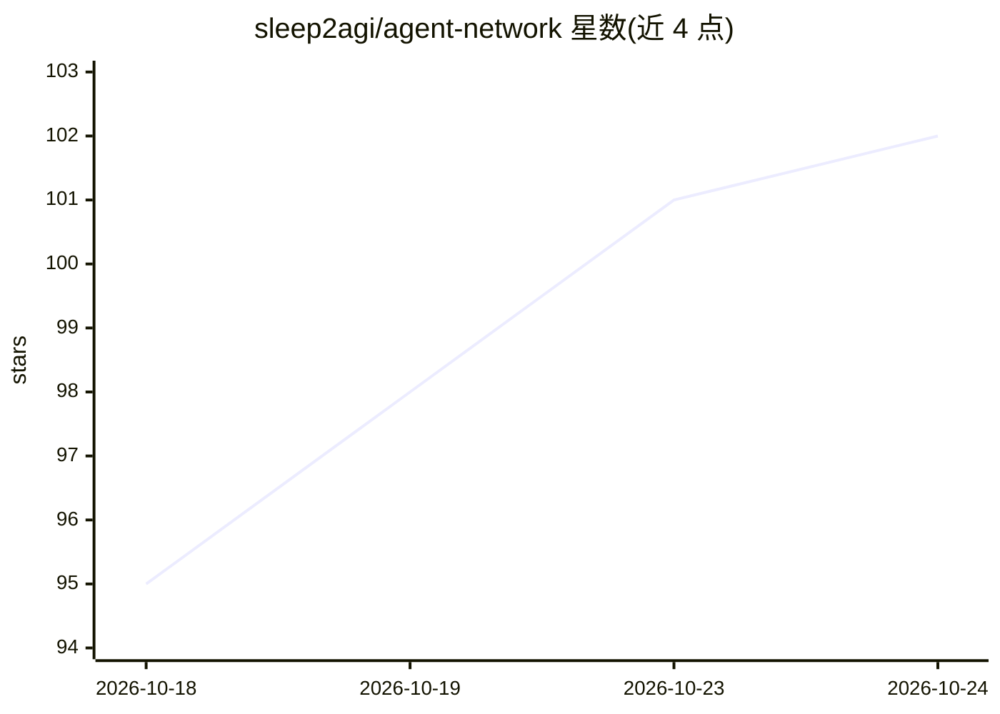

# sleep2agi/agent-network

⭐ 104 · TypeScript · Apache-2.0 · 推送 2026-10-24 · [GitHub](https://github.com/sleep2agi/agent-network) · [官网](https://anet.sh) · 组织维护 · 中文 README

**把多台机器上的编码 Agent 连成网络统一指挥的自托管工具**

面向使用 Claude Code、Codex、Grok Build、OpenCode 等编码 Agent 的开发者：每台机器运行 anet daemon，节点通过 MCP 互相发现、派活，通过 SSE 实时收任务；CommHub 串起各机器并存储 SQLite 数据，全程自托管不做 SaaS。提供桌面（macOS/Windows）、Android 客户端与 Web Dashboard，支持聊天派活、任务看板、远程创建/启停节点、切模型与重启。CLI 方式需 Node.js ≥ 22.13，Hub 运行在 Bun 上；OpenCode V2 与 Grok Build TUI 共存等特性标注为实验性预览。

## 筛选速览

| 维度 | 判定 | 备注 |
|---|---|---|
| AI 角色 | `ai-ecosystem` | LLM/agent 周边工具 |
| 许可风险 | `permissive` | Apache-2.0 |
| 部署形态 | `library` | 以包/库形式分发 |
| 模型依赖 | locked-api |  |
| 硬件要求 | — | 无带数字的原话,不猜 |
| 安装摩擦 | `low` | 无编译、无系统依赖或容器化 |
| 成熟度 | `idea` | |

## 能力要点

- 6 种 Agent 运行时接入同一网络，节点间通过 MCP 互相派活
- 桌面/Android/Web 客户端远程管理节点、任务看板与文件收发
- 自托管本地优先，Hub 与 SQLite 数据运行在用户自己机器
- claude-agent-sdk 兼容 Anthropic 及 MiniMax、DeepSeek、GLM、Kimi 等 API

## 适用场景

- 把多台机器上的 Claude Code / Codex / Grok 节点组网协作
- 在一个客户端里集中派活、跟踪任务与管理项目
- 自托管方式管理 Agent 军团而不依赖 SaaS

## 场景标签

`编码 Agent` `多智能体` · 领域:Agent 开发

## 证据(README 行号)

> L22: - 🤖 **一支跨机器的 Agent 军团** —— Claude Code、Claude Agent SDK、Codex、Grok Build、OpenCode 都能作为节点接入同一个网络，节点之间通过 MCP 互相发现、互相派
> L23: - 🛰️ **一个 Hub 串起所有机器** —— CommHub 通过 MCP 暴露工具、通过 SSE 实时投递任务；每台机器跑一个 `anet daemon`，就能从客户端远程创建、启动和停止那台机器上的节点。
> L56: 每个节点都是一个 `agent-node` 进程，包着一种 Agent 运行时，通过 MCP 调用 Hub 的工具（查队友、派任务、回复），通过 SSE 实时收任务。daemon 是一个特殊节点（`host_supervisor`

## 星数曲线

2026-10-18 95 → 2026-10-24 102（+7）

---
*卡片 v1 · prompt 1.4 · 生成 2026-10-23 · 置信度 mid · 依据 README sha `03d5ba6a1d9d` · [字段定义](../../DATASET.md)*
