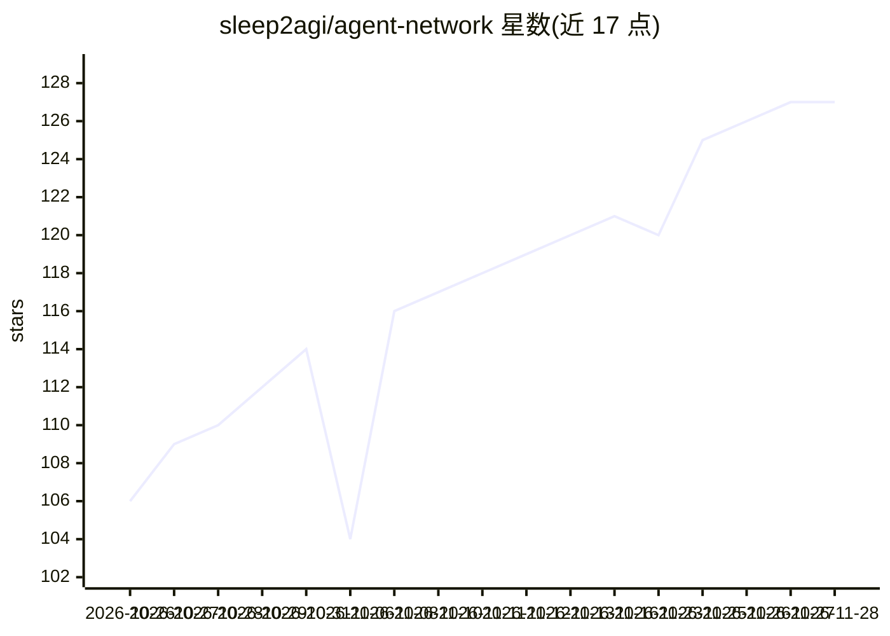

# sleep2agi/agent-network

⭐ 127 · TypeScript · Apache-2.0 · 推送 2026-11-27 · [GitHub](https://github.com/sleep2agi/agent-network) · [官网](https://anet.sh) · 组织维护 · 中文 README

**多 Agent 组网协作工具：把多台机器上的编码 Agent 连成一队统一指挥**

通过一个 Hub 将多台机器上的 Claude Code、Codex、Grok Build、OpenCode 等 Agent 运行时节点连成网络，节点经 MCP 互相发现并派发任务，通过 SSE 实时接收。每台机器运行 anet daemon 供远程管理节点；桌面端（macOS/Windows）与 Android 客户端支持聊天派活、收发文件、任务看板、查看节点日志与规则文件。Hub 与数据留在本机，不做 SaaS 托管。CLI 方式需要 Node.js ≥ 22.13，Hub 运行在 Bun 上。

## 筛选速览

| 维度 | 判定 | 备注 |
|---|---|---|
| AI 角色 | `ai-ecosystem` | LLM/agent 周边工具 |
| 许可风险 | `permissive` | Apache-2.0 |
| 部署形态 | `library` | 以包/库形式分发 |
| 模型依赖 | locked-api |  |
| 硬件要求 | — | 无带数字的原话,不猜 |
| 安装摩擦 | `low` | 无编译、无系统依赖或容器化 |
| 成熟度 | — | 结构信号不足 |

## 能力要点

- 跨机器 Agent 组网：节点经 MCP 互相发现、互相派活，SSE 实时收任务
- anet daemon 远程创建、启动、停止指定机器上的节点
- 桌面与 Android 客户端：聊天派活、文件收发、任务看板、节点日志查看
- 支持 7 种 Agent 运行时，含 Web Dashboard

## 适用场景

- 在多台机器上部署编码 Agent 并从一个客户端统一指挥
- 团队私有化部署 Agent 协作网络
- 用任务看板管理 Agent 执行的需求池与进行中任务

## 场景标签

`多智能体` `编码 Agent` · 领域:Agent 开发

## 证据(README 行号)

> L14: - **一支跨机器的 Agent 军团**：Claude Code、Claude Agent SDK、Codex、Grok Build、OpenCode 都能作为节点接入同一个网络，节点之间通过 MCP 互相发现、互相派活。
> L46: 每个节点是一个 `agent-node` 进程，包着一种 Agent 运行时：通过 MCP 调用 Hub 的工具（查队友、派任务、回复），通过 SSE 实时收任务。daemon 是一个特殊节点，替 Hub 在它所在的机器上创建、启
> L50: |Runtime|Agent|登录方式|人机共用 TUI|

## 星数曲线

2026-10-26 106 → 2026-11-28 127（+21）

---
*卡片 v1 · prompt 1.4 · 生成 2026-11-28 · 置信度 high · 依据 README sha `ae5d72e70836` · [字段定义](../../DATASET.md)*
