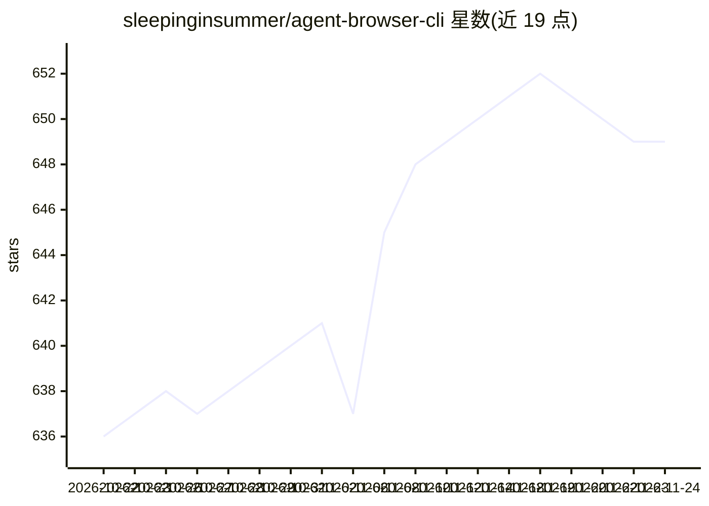

# sleepinginsummer/agent-browser-cli

⭐ 649 · Rust · MIT · 推送 2026-11-02 · [GitHub](https://github.com/sleepinginsummer/agent-browser-cli) · [官网](https://www.npmjs.com/package/@sleepinsummer/agent-browser-cli) · 个人维护 · 中文 README

**给 AI Agent 提供浏览器感知与控制能力的 CLI**

通过 Chrome 扩展连接用户真实浏览器，保留登录态和 Cookie，为 codex、claude code、opencode 等 Agent CLI 提供标签页扫描/切换、页面 JS 执行、Cookie 读取、CDP 控制、截图、文件上传、下拉框与表单操作等命令。CLI 端用 Rust 实现，含常驻 daemon 与启动锁，支持多 Profile 别名路由与 WebSocket 端口配置。需配合 Chrome 扩展使用，README 明确其不是 Selenium/Playwright。

## 筛选速览

| 维度 | 判定 | 备注 |
|---|---|---|
| AI 角色 | `ai-ecosystem` | LLM/agent 周边工具 |
| 许可风险 | `permissive` | MIT |
| 部署形态 | `library` | 以包/库形式分发 |
| 模型依赖 | — | README 未给出锁定关系 |
| 硬件要求 | — | 无带数字的原话,不猜 |
| 安装摩擦 | `medium` | 含编译或系统依赖之一 |
| 成熟度 | — | 结构信号不足 |

## 能力要点

- 通过 Chrome 扩展复用真实浏览器登录态与 Cookie
- 提供标签页扫描、JS 执行、CDP、截图、文件上传等命令
- 附带 skills/agent-browser-cli/SKILL.md 供 AI 参考
- 支持多 Chrome Profile 别名（--profile）与自定义 WebSocket 端口

## 适用场景

- 让 Agent 操作管理后台、配置页面、表单系统等网页工具
- 复用登录态做需认证页面的数据提取
- 前端页面 Debug：读 DOM、执行 JS、截图确认
- 自动化验证页面流程：表单提交、按钮点击、跳转检查

## 场景标签

`浏览器自动化` · 领域:效率与自动化

## 证据(README 行号)

> L18: `agent-browser-cli` 是一个面向 Agent 的浏览器感知与控制工具。它通过 Chrome 扩展连接用户真实浏览器，保留登录态和 Cookie，提供标签页扫描、页面 JS 执行、Cookie 读取、CDP 控制、
> L40: - 从 GenericAgent 中拆出浏览器控制能力，使用cli 提供给codex、claude code、opencode使用。GenericAgent浏览器插件不需要重新安装，可以共用同一个插件

## 星数曲线

2026-10-22 636 → 2026-11-24 649（+13）

---
*卡片 v1 · prompt 1.4 · 生成 2026-11-24 · 置信度 high · 依据 README sha `cef7a2d400d8` · [字段定义](../../DATASET.md)*
