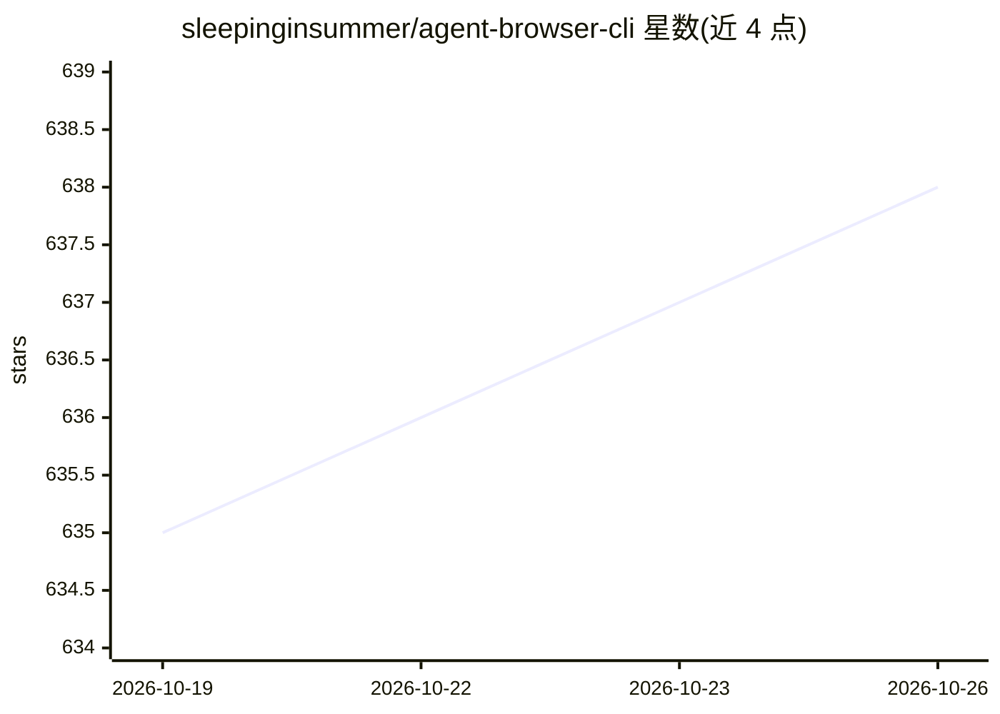

# sleepinginsummer/agent-browser-cli

⭐ 638 · Rust · MIT · 推送 2026-10-19 · [GitHub](https://github.com/sleepinginsummer/agent-browser-cli) · [官网](https://www.npmjs.com/package/@sleepinsummer/agent-browser-cli) · 个人维护 · 中文 README

**面向 AI Agent 的浏览器感知与控制 CLI，复用 Chrome 登录态**

Rust 实现的命令行工具，通过 Chrome 扩展（tmwd_cdp_bridge）连接用户真实浏览器会话，保留登录态与 Cookie，提供标签页扫描/切换、页面 JS 执行、Cookie 读取、CDP 控制、截图、文件上传、下拉框与表单操作等能力。支持 npm 安装或本地 cargo 构建，Windows/Mac/Linux 可用，WSL 需 2.0.0+ 与镜像网络模式。提供 SKILL.md 供 Agent 使用，供 codex、claude code、opencode 等 CLI Agent 调用，自称不是 Selenium/Playwright 替代品，更适合在已有浏览器会话中辅助 Agent 操作。

## 筛选速览

| 维度 | 判定 | 备注 |
|---|---|---|
| AI 角色 | `ai-ecosystem` | LLM/agent 周边工具 |
| 许可风险 | `permissive` | MIT |
| 部署形态 | `library` | 以包/库形式分发 |
| 模型依赖 | — | README 未给出锁定关系 |
| 硬件要求 | — | 无带数字的原话,不猜 |
| 安装摩擦 | `medium` | 含编译或系统依赖之一 |
| 成熟度 | — | 结构信号不足 |

## 能力要点

- 通过 Chrome 扩展复用真实浏览器登录态与 Cookie
- 标签页扫描/切换、页面 JS 执行、CDP、截图、文件上传等命令
- 提供 SKILL.md 与 AI 一句话安装，供 claude code/codex/opencode 调用
- Rust 实现常驻服务，避免重复初始化连接，支持多 Profile label

## 适用场景

- 让 AI Agent 操作需要登录态的网页后台或表单系统
- 复用真实浏览器环境做页面流程验证与自动化测试
- 读取 DOM/执行 JS/截图辅助前端调试与网页数据采集

## 场景标签

`浏览器自动化` `网页抓取` · 领域:效率与自动化

## 证据(README 行号)

> L3: 面向 Agent 的浏览器感知与控制 CLI，把真实 Chrome 会话变成可复用的标签页扫描、页面 JS、Cookie、CDP 和截图能力。
> L17: `agent-browser-cli` 是一个面向 Agent 的浏览器感知与控制工具。它通过 Chrome 扩展连接用户真实浏览器，保留登录态和 Cookie，提供标签页扫描、页面 JS 执行、Cookie 读取、CDP 控制、
> L39: - 从 GenericAgent 中拆出浏览器控制能力，使用cli 提供给codex、claude code、opencode使用。GenericAgent浏览器插件不需要重新安装，可以共用同一个插件

## 星数曲线

2026-10-19 635 → 2026-10-26 638（+3）

---
*卡片 v1 · prompt 1.4 · 生成 2026-10-21 · 置信度 high · 依据 README sha `d496ccd8afaa` · [字段定义](../../DATASET.md)*
