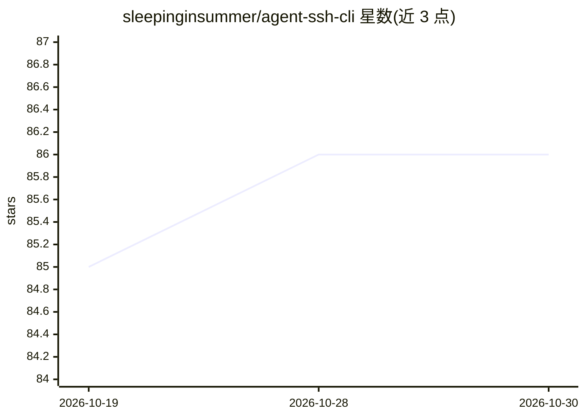

# sleepinginsummer/agent-ssh-cli

⭐ 86 · Rust · MIT · 推送 2026-10-26 · [GitHub](https://github.com/sleepinginsummer/agent-ssh-cli) · [官网](https://www.npmjs.com/package/agent-ssh-cli) · 个人维护 · 中文 README

**给 Agent 调用的 SSH 命令行工具：远程执行与文件传输**

用 Rust/Node 发布的 CLI（agentsshcli），把 SSH 远程执行、文件上传下载、连接配置、命令黑白名单封装为本地命令，并通过 SKILL.md 集成到 AI agent 中。能力包括断点续传、JSON 结构化输出、跳板机、SOCKS5 代理、sudo/su 提权、可视化配置编辑器（仅监听 127.0.0.1）以及凭据加密存储与 known_hosts 指纹确认。设计参考 classfang/ssh-mcp-server，改写为独立 CLI 形式，面向需要让 agent 执行服务器运维、部署等操作的用户。

## 筛选速览

| 维度 | 判定 | 备注 |
|---|---|---|
| AI 角色 | `ai-ecosystem` | LLM/agent 周边工具 |
| 许可风险 | `permissive` | MIT |
| 部署形态 | `library` | 以包/库形式分发 |
| 模型依赖 | — | README 未给出锁定关系 |
| 硬件要求 | — | 无带数字的原话,不猜 |
| 安装摩擦 | `low` | 无编译、无系统依赖或容器化 |
| 成熟度 | — | 结构信号不足 |

## 能力要点

- 远程执行/上传/下载以 CLI 命令暴露给 Agent，SKILL.md 集成
- 上传下载支持断点续传与失败重试，exec 输出结构化 JSON
- 命令白名单/黑名单（JavaScript RegExp）限制可执行命令
- known_hosts 指纹确认、凭据加密存储、可视化配置编辑器

## 适用场景

- 让 AI agent 在白名单约束下自动运维远程服务器
- 通过 agent 部署代码、更新 docker、配置 nginx
- 向 agent 提供带断点续传的远端文件传输能力

## 场景标签

 · 领域:开发运维工具/Agent 基础设施

## 证据(README 行号)

> L3: 基于 CLI 的 SSH 代理工具，按 ssh-mcp-server 的能力映射为 Agent 可调用的远端操作能力。
> L20: 本项目参考 classfang/ssh-mcp-server 的 SSH 操作能力设计，改写为独立 CLI 形式。感谢原项目提供的思路和能力基础。
> L81: 打开 SKILL.md，将其添加到 agent 中。

## 星数曲线

2026-10-19 85 → 2026-10-30 86（+1）

---
*卡片 v1 · prompt 1.4 · 生成 2026-10-24 · 置信度 high · 依据 README sha `e851e5828ad8` · [字段定义](../../DATASET.md)*
