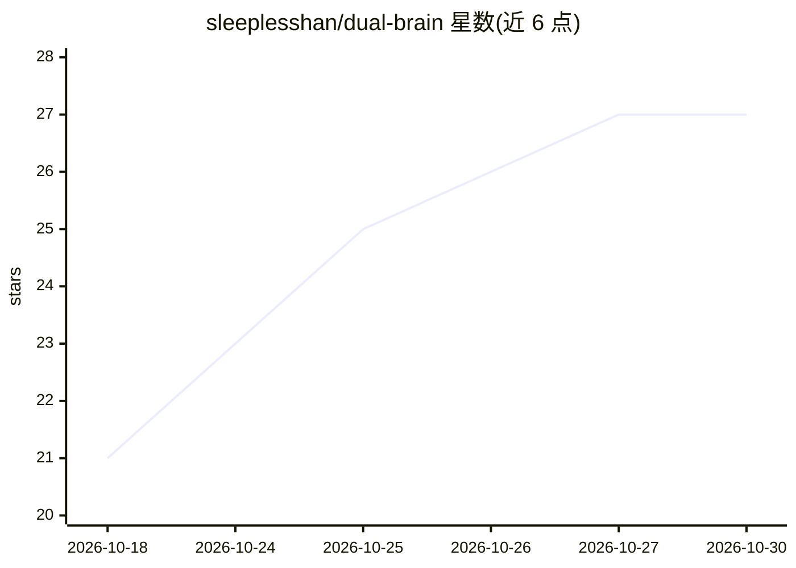

# sleeplesshan/dual-brain

⭐ 27 · Python · MIT · 推送 2026-10-20 · [GitHub](https://github.com/sleeplesshan/dual-brain) · 个人维护 · 中文 README

**编码智能体的双脑审查技能：宏观设计+微观代码互补评审**

面向 Codex、Claude Code 等编码智能体宿主的可移植技能（skill）：将认知负载拆为右脑（宏观架构、跨组件影响、备选方案）与左脑（具体契约、边界情况、代码实现）两个审查角色，由主智能体整合为最终结果，并将持久决策写入项目内存（.dual-brain/MEMORY.md，Hot/Warm/Cold/Archived 分层）。简单编辑走短程本地审查。通过 git clone 安装到宿主技能目录，无运行时依赖；附 Python 基准测试套件（core5）。以 Codex 为主要验证目标，其他宿主为兼容目标。

## 筛选速览

| 维度 | 判定 | 备注 |
|---|---|---|
| AI 角色 | `ai-ecosystem` | LLM/agent 周边工具 |
| 许可风险 | `permissive` | MIT |
| 部署形态 | `None` |  |
| 模型依赖 | — | README 未给出锁定关系 |
| 硬件要求 | — | 无带数字的原话,不猜 |
| 安装摩擦 | `low` | 无编译、无系统依赖或容器化 |
| 成熟度 | — | 结构信号不足 |

## 能力要点

- 右脑宏观审查与左脑微观审查的双角色分工与整合流程
- 项目内存分层（Hot/Warm/Cold/Archived），仅存决策与证据
- 子智能体不可用时报告本地两遍回退，不伪装独立审查
- 提供 core5 基准套件对比有无内存与双脑模式的正确率/耗时/token

## 适用场景

- 在模糊设计、高风险重构或不熟悉的集成任务中做互补评审
- 为编码智能体项目沉淀可复用的决策记忆
- 比较不同编排与内存策略下的任务表现

## 场景标签

`代码审查` `多智能体` `编码 Agent` · 领域:Agent 开发

## 证据(README 行号)

> L7: A portable skill for complementary review and durable project memory. The Right Brain takes the macro view of the pr
> L27: For hosts such as Claude Code, use that host's skill directory (for example `~/.claude/skills/dual-brain`) and avai
> L51: The exact contract lives in SKILL.md. Tool adaptation and model selection are in references/runtime.md.

## 星数曲线

2026-10-18 21 → 2026-10-30 27（+6）

---
*卡片 v1 · prompt 1.4 · 生成 2026-10-26 · 置信度 high · 依据 README sha `ddf233099fa6` · [字段定义](../../DATASET.md)*
