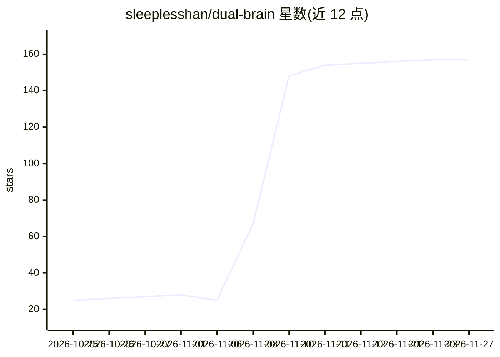

# sleeplesshan/dual-brain

⭐ 157 · Python · MIT · 推送 2026-11-06 · [GitHub](https://github.com/sleeplesshan/dual-brain) · 个人维护

**为 AI 编程助手提供左右脑互补审查与项目记忆的技能**

一个可移植的 agent 技能（skill）：Right Brain 负责宏观架构、跨组件影响与备选方案，Left Brain 负责契约、边界用例与代码级检查，主 agent 负责整合修改。内置 .dual-brain/MEMORY.md 的四级项目记忆（Hot/Warm/Cold/Archived），审查者只输出带证据的有限发现。适用于模糊设计、风险重构与陌生集成；简单改动走本地短审查路径。README 声明不保证每个任务结果更好或延迟更低，聊天模式下仅输出分析与补丁建议。

## 筛选速览

| 维度 | 判定 | 备注 |
|---|---|---|
| AI 角色 | `ai-ecosystem` | LLM/agent 周边工具 |
| 许可风险 | `permissive` | MIT |
| 部署形态 | `None` |  |
| 模型依赖 | locked-api |  |
| 硬件要求 | — | 无带数字的原话,不猜 |
| 安装摩擦 | `low` | 无编译、无系统依赖或容器化 |
| 成熟度 | — | 结构信号不足 |

## 能力要点

- 左右脑分工的多 agent 审查工作流（宏观架构 vs 代码契约）
- .dual-brain/MEMORY.md 四级项目记忆与迁移规则
- 支持 Codex、Claude Code、Grok、Grok Bot、Muse 五种接入方式
- 附带 benchmark 套件：对比单 agent 与 Dual-Brain 的表现

## 适用场景

- 重构授权层等高风险变更前做双重审查
- 对照已有项目决策比较多个缓存设计方案
- 在陌生第三方集成时让两个独立审查者互补检查

## 场景标签

`多智能体` `编码 Agent` · 领域:Agent 开发

## 证据(README 行号)

> L7: A portable skill for complementary review and durable project memory. The Right Brain takes the macro view of the pr
> L91: ## Current Codex and models
> L97: For a particular task, compare correctness, elapsed time, and reported token usage separately. More reasoning, more

## 星数曲线

2026-10-25 25 → 2026-11-27 157（+132）

---
*卡片 v1 · prompt 1.4 · 生成 2026-11-27 · 置信度 high · 依据 README sha `316dd64d9bd3` · [字段定义](../../DATASET.md)*
