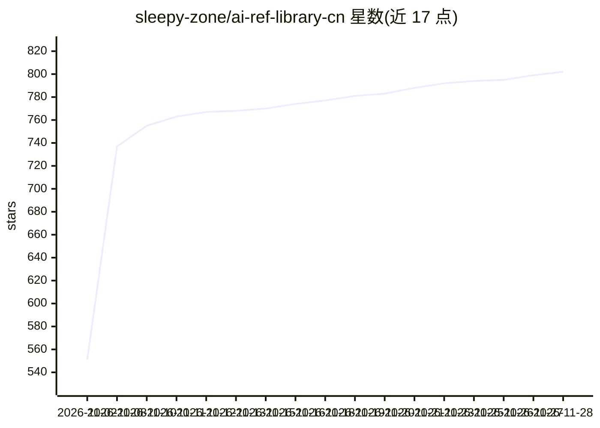

# sleepy-zone/ai-ref-library-cn

⭐ 802 · JavaScript · 推送 2026-11-27 · [GitHub](https://github.com/sleepy-zone/ai-ref-library-cn) · [官网](https://sleepyzone.online/ai-ref-library-cn/) · 个人维护 · 中文 README

**AI 作图参考素材库中文检索站：译标签、搜与复制提示词**

基于日本作者 @giaaibusi 公开的三套 AI 作图参考素材（脸库 1,499 张、姿势库 288 姿势/1,439 图、服装库 1,407 套）制作的中文检索网站，将分类与标签译为中文并支持中英双语搜索。核心机制包括三库统一入口、一键复制作图指令、随机组合从三库各抽一张并排展示并自动生成提示词（支持单独替换与限定范围）；提供两种参考图交付形式：给可联网 Agent 的源站直链+curl 命令，或给对话式图像模型的三联参考图。本地以静态页面运行（python http.server），本站开启 GA4 与 Clarity 埋点。

## 筛选速览

| 维度 | 判定 | 备注 |
|---|---|---|
| AI 角色 | `ai-knowledge` | 知识聚合/清单类 |
| 许可风险 | `none` | — |
| 部署形态 | `None` |  |
| 模型依赖 | — | README 未给出锁定关系 |
| 硬件要求 | — | 无带数字的原话,不猜 |
| 安装摩擦 | `low` | 无编译、无系统依赖或容器化 |
| 成熟度 | — | 结构信号不足 |

## 能力要点

- 三库统一入口，分类标签中文化+中英双语搜索
- 随机组合：脸/服装/姿势各抽一张并自动生成现成提示词
- 两种参考图交付：联网 Agent 用直链+curl，对话模型用 2828×1380 三联图
- 姿势库支持 depth，缩略图用于检索，原图走源站/网盘下载

## 适用场景

- 画图前快速检索合适的脸部、姿势、服装参考
- 用随机组合反复试不同脸+衣服+姿势的搭配
- 把三联参考图直接贴给对话式图像模型出图
- 给可联网的编码 Agent 提供直链参考图做作图

## 场景标签

`图像生成` `提示工程` · 领域:Agent 开发

## 证据(README 行号)

> L5: 基于 **あぎ / ギア（@giaaibusi）** 公开的三套 AI 作图参考素材的中文版网站。
> L11: * **随机组合生成提示词**。

## 星数曲线

2026-11-02 551 → 2026-11-28 802（+251）

---
*卡片 v1 · prompt 1.4 · 生成 2026-11-27 · 置信度 high · 依据 README sha `ee2425359239` · [字段定义](../../DATASET.md)*
