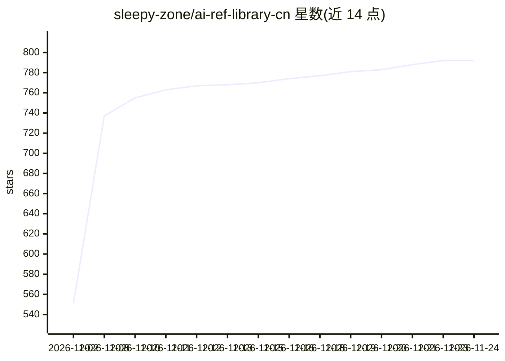

# sleepy-zone/ai-ref-library-cn

⭐ 792 · JavaScript · 推送 2026-11-20 · [GitHub](https://github.com/sleepy-zone/ai-ref-library-cn) · [官网](https://sleepyzone.online/ai-ref-library-cn/) · 个人维护 · 中文 README

**面向中文 AI 绘图用户的三套作图参考素材检索站**

基于日本作者 @giaaibusi 公开的三套 AI 作图参考素材（脸库 1,499 张、姿势库 288 姿势/1,439 图、服装库 1,407 套）制作的中文检索网站：分类标签译成中文，支持中英双语搜索、一键复制作图指令；提供「随机组合」功能，从三库各抽一条并排展示参考图并自动生成提示词。针对能联网取图的 Agent 与只能贴图的对话式图像模型，分别输出带源站直链的提示词或 2828×1380 三联参考图。本地以静态页面运行，原图经网盘分发，仓库仅收录缩略图。

## 筛选速览

| 维度 | 判定 | 备注 |
|---|---|---|
| AI 角色 | `ai-knowledge` | 知识聚合/清单类 |
| 许可风险 | `none` | — |
| 部署形态 | `None` |  |
| 模型依赖 | — | README 未给出锁定关系 |
| 硬件要求 | — | 无带数字的原话,不猜 |
| 安装摩擦 | `low` | 无编译、无系统依赖或容器化 |
| 成熟度 | — | 结构信号不足 |

## 能力要点

- 三库统一入口，分类与标签全中文，中英双语搜索
- 随机组合：三库各抽一条自动生成现成提示词
- 两种参考图形式：联网 Agent 用源站直链+curl，贴图模型用三联参考图
- 姿势库支持 depth，可按机位、季节、风格限定抽样范围

## 适用场景

- AI 作图时按中文分类快速查找脸部、姿势、服装参考
- 用随机组合功能生成提示词和三张参考图搭配
- 给能联网取图的编码 Agent 提供带直链的作图指令

## 场景标签

`图像生成` · 领域:内容生成

## 证据(README 行号)

> L5: 基于 **あぎ / ギア（@giaaibusi）** 公开的三套 AI 作图参考素材的中文版网站。
> L19: 点顶部 **🎲 随机组合**：从脸库、服装库、姿势库各随机抽一条，三张参考图并排，并自动生成现成的提示词。
> L76: |脸库|正面向、纯色背景的头部参考（脸部特写 893 / 造型 606）|1,499 张|<https://ai-portrait-gallery.pages.dev/>|

## 星数曲线

2026-11-02 551 → 2026-11-24 792（+241）

---
*卡片 v1 · prompt 1.4 · 生成 2026-11-24 · 置信度 high · 依据 README sha `3b06d527de87` · [字段定义](../../DATASET.md)*
