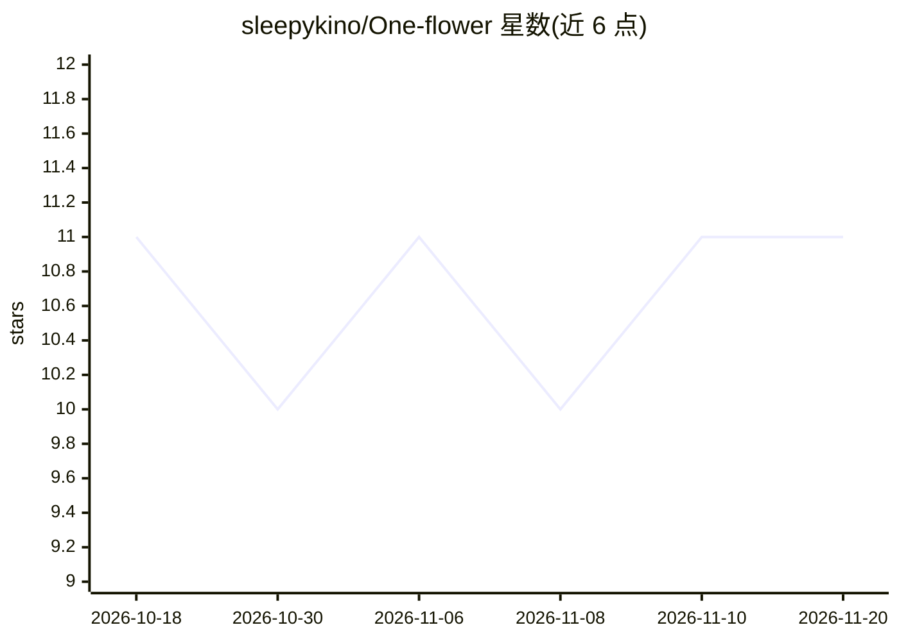

# sleepykino/One-flower

⭐ 11 · TypeScript · Apache-2.0 · 推送 2026-09-07 · [GitHub](https://github.com/sleepykino/One-flower) · 个人维护 · 中文 README

**面向小说作者的本地优先 AI 创作工作台**

基于 Tauri 2 + React 的桌面端小说创作应用，提供富文本编辑器、章节树、角色卡、世界书 RAG、伏笔追踪、世界地图、图片生成与剧本分镜工作台。AI 部分支持续写/改写/对白/检查四模式，通过 agents.md/全局提示词/Skill 文风包三层指令与 hook.md 输出校验控制生成；数据以 SQLite + 文件系统存于本机，API Key 存于系统钥匙串。云端与本地模型均可接入，Releases 提供打包版本，也可从源码编译。

## 筛选速览

| 维度 | 判定 | 备注 |
|---|---|---|
| AI 角色 | `ai-native` | 本体是模型或模型工具 |
| 许可风险 | `permissive` | Apache-2.0 |
| 部署形态 | `library` | 以包/库形式分发 |
| 模型依赖 | local-ok | 支持本地模型 |
| 硬件要求 | — | 无带数字的原话,不猜 |
| 安装摩擦 | `low` | 无编译、无系统依赖或容器化 |
| 成熟度 | — | 结构信号不足 |

## 能力要点

- 续写/改写/对白/检查四模式，多候选生成与多轮会话微调
- 世界书向量化 RAG 与章节片段三路召回注入上下文
- agents.md / 全局提示词 / Skill 文风包三层指令 + hook.md 输出校验
- SQLite + 文件系统本地存储，配合 Ollama 可完全离线

## 适用场景

- 长篇小说的设定管理与一致性检查
- 断网环境下用本地模型离线续写
- 将小说章节转化为剧本与分镜
- 为作品生成封面与插图

## 场景标签

`AI 写作` `RAG` `提示工程` · 领域:Agent 开发

## 证据(README 行号)

> L3: **AI 辅助的小说创作工作台**
> L52: ### 🤖 AI 辅助（四模式）
> L34: - **模型自由**：云端（DeepSeek / 智谱 / Kimi / 通义 / OpenAI / Claude / Gemini / 硅基流动…）与本地（Ollama / LM Studio / ComfyUI）即配即用，按功

## 星数曲线

2026-10-18 11 → 2026-11-20 11（+0）

---
*卡片 v1 · prompt 1.4 · 生成 2026-11-18 · 置信度 high · 依据 README sha `f7b3a8a34bb9` · [字段定义](../../DATASET.md)*
