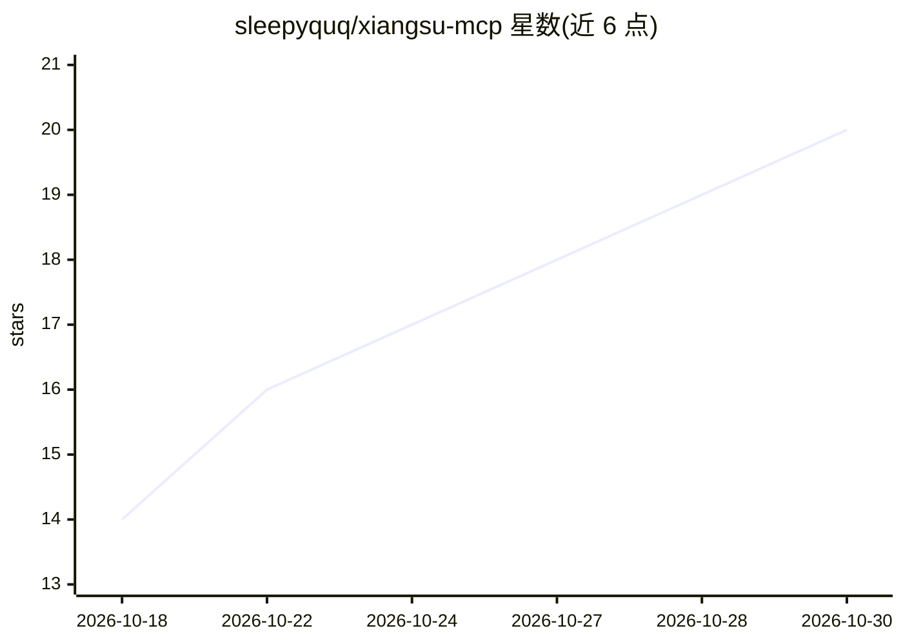

# sleepyquq/xiangsu-mcp

⭐ 20 · JavaScript · MIT · 推送 2026-10-28 · [GitHub](https://github.com/sleepyquq/xiangsu-mcp) · 个人维护 · 中文 README

**让 AI Agent 通过 MCP 操作抖音像塑 AR 特效编辑器的服务器**

独立社区开发的 MCP 服务器（Node.js + stdio），通过编辑器侧用户插件桥接，向 MCP 客户端暴露像塑特效编辑器的场景读写、素材绑定、TypeScript 脚本初始化、官方编译、预览截图、触摸/动作模拟与 MP4 录制等能力，共 105 个工具入口（含兼容与未接入云端入口，非全部实测）。面向使用像塑做抖音 AR 特效并希望由 AI Agent 辅助开发的使用者。限制：仅 Windows，实测版本为像塑 9.4.0/9.4.1/9.5.2，国际版 Effect House 与 macOS 未验证，官方云端生成入口未接入，多步操作非原子事务。

## 筛选速览

| 维度 | 判定 | 备注 |
|---|---|---|
| AI 角色 | `ai-ecosystem` | LLM/agent 周边工具 |
| 许可风险 | `none` | MIT |
| 部署形态 | `desktop` | 安装包/桌面程序 |
| 模型依赖 | — | README 未给出锁定关系 |
| 硬件要求 | — | 无带数字的原话,不猜 |
| 安装摩擦 | `low` | 无编译、无系统依赖或容器化 |
| 成熟度 | `idea` | |

## 能力要点

- 105 个 MCP 工具入口：场景读写、脚本开发、编译、试玩、截图与录制
- 编辑器侧经用户插件桥接，不修改像塑官方二进制
- 工程文件限定路径读写并带 SHA256 覆盖保护与备份
- 71 个 eh_* 本地命令入口映射官方命令（尚未逐项实测）

## 适用场景

- 让 AI Agent 在像塑中搭建和修改 AR 特效场景
- 通过 Agent 初始化 TypeScript 脚本、编译并根据错误修复
- 自动化试玩验证：截图、触摸模拟、动作切换与短视频录制

## 场景标签

`GUI 自动化` · 领域:效率与自动化

## 证据(README 行号)

> L3: 让 AI Agent 通过 Model Context Protocol（MCP）操作抖音像塑：编辑场景、绑定素材、初始化 TypeScript 脚本、编译、截图和验证交互。
> L5: **Xiangsu MCP is an independent MCP server for the Douyin Xiangsu AR effect editor.** It exposes scene editing, asse
> L109: 如果客户端找不到 `node`，用 `Get-Command node` 查询路径，并将 `command` 替换为 `node.exe` 的绝对路径。服务使用 stdio，由客户端启动，不需要额外开放 HTTP 端口。配置后重

## 星数曲线

2026-10-18 14 → 2026-10-30 20（+6）

---
*卡片 v1 · prompt 1.4 · 生成 2026-10-28 · 置信度 high · 依据 README sha `2c4ca7a12eba` · [字段定义](../../DATASET.md)*
